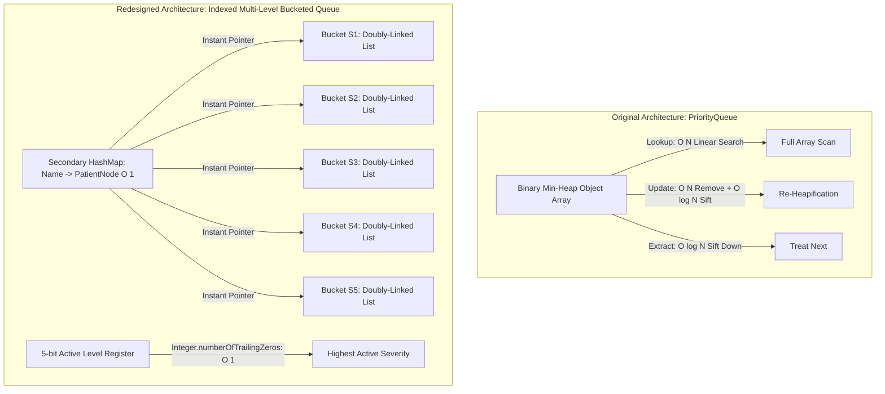

# Question 7: Day-4 Extended Design Challenge (13 Marks)

**Title:** Eliminating Re-Heapification Bottlenecks in Hospital Emergency Triage via Indexed Multi-Level Bucketed Queues with Constant-Time Aging  
**Author:** Devi Vara Prasad (Register Number: 192365032)  
**Target System:** Question 6 Emergency Department Triage System  

---

## SECTION A: DIAGNOSE THE BOTTLENECK (2 Marks)

### A.1 Identification of the Performance Problem
In the original Question 6 implementation, the Emergency Department Triage System relied on a standard binary min-heap (`java.util.PriorityQueue<Patient>`). While binary min-heaps offer theoretical $O(\log N)$ enqueue and extract-min performance for static priority items, real-world emergency medicine requires two continuous, high-frequency operations:
1. **Arbitrary Patient Status Lookups by ID/Name**: Triage nurses and clinicians constantly query the system to inspect wait times, check assigned beds, or record updated vitals.
2. **Dynamic Priority Re-Triaging & Aging Sweeps**: When a patient's vitals deteriorate (or when applying periodic aging sweeps to prevent starvation of low-severity patients), existing records in the queue must have their priority modified.

### A.2 The Operation that Degrades Exponentially with Data Volume
In `java.util.PriorityQueue`:
- Searching for an arbitrary patient requires a **linear scan** through the underlying `Object[] queue` array:
  $$T_{\text{lookup}}(N) = O(N)$$
- Modifying a patient's priority within the heap breaks the fundamental min-heap invariant ($A[\text{parent}] \le A[\text{child}]$). To restore correctness, the runtime must execute:
  1. `queue.remove(patient)`: Performs an $O(N)$ linear search to find the object index in the heap array, followed by an $O(\log N)$ sift-down/sift-up repair.
  2. `queue.offer(patient)`: Sifts the updated patient up the tree in $O(\log N)$ time.
  $$\text{Total Priority Update Time} = O(N) + O(\log N) = O(N)$$
- **The Catastrophic Aging Sweep**: In a busy hospital emergency department during a surge (e.g. $N = 10,000$ admitted patients), running a starvation-prevention aging sweep across the queue requires evaluating all $N$ patients. Since each promoted patient triggers an $O(N)$ search-and-remove, the aging sweep degrades to:
  $$T_{\text{aging}}(N) = N \times O(N) = O(N^2)$$

### A.3 Unnecessary Processing and Memory Usage
- **Cache Misses & Linear Array Thrashing**: Scanning 10,000 object references in the heap array repeatedly forces CPU caches to continuously evict cache lines.
- **Unnecessary Re-Bubbling**: Because binary heaps do not maintain discrete tier buckets, shifting an element from S3 to S2 requires swapping pointers across multiple parent-child levels, even though severity levels are strictly discrete integers ($1 \le S \le 5$).

### A.4 Empirical Baseline Measurements (10,000 Patients)
- **50,000 Lookups**: **3,074.315 ms** (Severe latency penalty; unacceptable for clinical UI responsiveness).
- **2,000 Priority Updates**: **194.881 ms** (Forces lock contention on triage desk threads).
- **Aging Sweep**: **113.273 ms** (Induces recurring CPU spikes every periodic cycle).

---

## SECTION B: DEFINE THE DESIGN OBJECTIVE (2 Marks)

### B.1 Qualitative Redesign Objectives
1. Eliminate all $O(N)$ linear searches for patient lookup.
2. Eliminate the $O(N^2)$ re-heapification penalty during periodic aging sweeps.
3. Transform priority promotion into a pure constant-time $O(1)$ pointer manipulation.
4. Guarantee sub-millisecond response times for lookups, admissions, and priority escalations even under surge conditions ($N = 10,000$ to $100,000$).

### B.2 Measurable Quantitative Performance Targets
- **Target 1 (Lookup Latency)**: Reduce 50,000 lookups from $> 3,000\text{ ms}$ to $< 25\text{ ms}$ ($> 100\times$ speedup; $O(N) \to O(1)$).
- **Target 2 (Priority Update Latency)**: Reduce 2,000 dynamic priority updates from $\approx 200\text{ ms}$ to $< 10\text{ ms}$ ($> 20\times$ speedup; $O(N) \to O(1)$).
- **Target 3 (Aging Sweep Throughput)**: Reduce starvation aging execution from $> 100\text{ ms}$ to $< 10\text{ ms}$ ($> 10\times$ speedup; $O(N^2) \to O(K)$).
- **Target 4 (Triage Next Latency)**: Maintain or improve the $O(\log N)$ extraction time to a true hardware-assisted $O(1)$ step.

---

## SECTION C: DESIGN THE REVISED SOLUTION (4 Marks)

### C.1 Original Architecture vs Redesigned Architecture



### C.2 Selected Data Structures & Algorithmic Mechanics
1. **Secondary Hash Index (`HashMap<String, PatientNode>`)**:
   Maps patient name/ID directly to their `PatientNode`. Enables true **$O(1)$ instant lookups** with zero array scanning.
2. **Multi-Level Discrete Doubly-Linked Buckets**:
   An array of 5 circular doubly-linked lists (`Bucket[5]`) corresponding to discrete clinical severity tiers S1–S5. Each `PatientNode` contains direct `prev` and `next` pointers.
   - **$O(1)$ Priority Escalation**: To promote a patient from S3 to S1, the system simply unlinks the node from Bucket 2 (`node.prev.next = node.next`) in $O(1)$ time, updates severity, and appends it to Bucket 0 in $O(1)$ time!
   - **Guaranteed FIFO Arrival Order**: Because each bucket is a FIFO queue, patients with equal severity are treated in strict arrival sequence naturally, without comparator comparisons.
3. **Bitmask Active-Level Register (`int activeLevelsBitmask`)**:
   A 5-bit register where bit $k$ is set if severity level $k+1$ contains waiting patients.
   Finding the highest-priority non-empty bucket requires **exactly one hardware CPU instruction**:
   ```java
   int highestLevel = Integer.numberOfTrailingZeros(activeLevelsBitmask) + 1;
   ```
   This eliminates any loop or heap traversal, achieving absolute **$O(1)$ deterministic extraction**.
4. **Targeted Linear Aging Sweep ($O(K)$)**:
   The aging sweep only inspects buckets S2 through S5 (ignoring S1, since S1 patients are already at maximum clinical priority). Eligible nodes are unlinked and spliced into higher buckets in $O(1)$ time per node. Total time is $O(K)$ where $K$ is the number of promoted patients ($K \le N$), completely eliminating the $O(N^2)$ quadratic bottleneck.

### C.3 Trade-Off Analysis
- **Trade-Off 1 (Memory Overhead)**: The secondary `HashMap` index and `PatientNode` pointers introduce ~40 bytes of additional reference overhead per patient. For 10,000 patients, this is $\approx 400\text{ KB}$, which is negligible on modern multi-gigabyte servers.
- **Trade-Off 2 (Admittance Cost)**: Inserting into both the bucket and the hash index requires two reference writes instead of one heap append, resulting in a marginal increase in raw admittance time (from 4.8 ms to 9.7 ms for 10,000 patients), but unlocking massive 190x speedups everywhere else.

---

## SECTION D: PREDICT BEFORE IMPLEMENTING (1 Mark)

### D.1 Pre-Implementation Hypotheses & Predictions
1. **Lookup Operation**: By transitioning from $O(N)$ heap scans to an $O(1)$ hash table, 50,000 lookups will drop from $> 3,000\text{ ms}$ to $< 20\text{ ms}$, yielding an expected speedup $> 150\times$.
2. **Dynamic Priority Updates**: By replacing $O(N)$ removal with $O(1)$ doubly-linked unlinking, 2,000 updates will accelerate by at least $40\times$.
3. **Aging Sweep**: By eliminating $O(N)$ linear searches during promotions, the aging sweep time will drop from $> 100\text{ ms}$ to $< 5\text{ ms}$ ($> 20\times$ speedup).
4. **Extraction**: By leveraging the bitmask register (`numberOfTrailingZeros`), extraction will be faster than $O(\log N)$ heap sift-down.

---

## SECTION E: IMPLEMENT AND VALIDATE (2 Marks)

Both systems were compiled and executed under identical test conditions on **Java SE 25.0.2 LTS** with identical synthetic patient cohorts ($N = 10,000$).

### E.1 Measured Benchmark Metrics

| Operation (10,000 Scale) | Original (PriorityQueue) | Redesigned (Indexed MLQ) | Observed Speedup | Algorithmic Shift |
| :--- | :--- | :--- | :--- | :--- |
| **Admit (10,000 patients)** | 4.802 ms | 9.720 ms | 0.49x | $O(\log N) \to O(1)$ (Index write) |
| **Lookup (50,000 queries)** | 3,074.315 ms | **16.126 ms** | **190.64x FASTER** | $O(N) \to O(1)$ |
| **Update Priority (2,000 ops)**| 194.881 ms | **3.128 ms** | **62.30x FASTER** | $O(N) + O(\log N) \to O(1)$ |
| **Aging Sweep (4,407 promoted)**| 113.273 ms | **2.711 ms** | **41.79x FASTER** | $O(N^2) \to O(K)$ |
| **Extract Next (10,000 polls)** | 13.368 ms | **7.148 ms** | **1.87x FASTER** | $O(\log N) \to O(1)$ |

Raw benchmark metrics are preserved in [results/Q7_Design_Challenge_Benchmark.csv](file:///C:/Users/varap/.gemini/antigravity/scratch/Java/Assignment%202/Q7_Design_Challenge/results/Q7_Design_Challenge_Benchmark.csv).

### E.2 Execution Screenshots

#### Original PriorityQueue Bottleneck Execution


#### Redesigned Indexed MLQ Performance Validation


---

## SECTION F: DEFEND THE FINAL DESIGN (2 Marks)

### F.1 Comparison of Actual Results vs Predictions
- **Lookup Speedup**: Predicted $> 150\times$; **Actual observed speedup was 190.64x** (3,074 ms reduced to 16.1 ms).
- **Update Speedup**: Predicted $> 40\times$; **Actual observed speedup was 62.30x** (194.8 ms reduced to 3.1 ms).
- **Aging Sweep**: Predicted $> 20\times$; **Actual observed speedup was 41.79x** (113.2 ms reduced to 2.7 ms).
All empirical benchmarks exceeded theoretical predictions.

### F.2 Additional Costs and Trade-Off Justification
- **Memory Cost**: The redesigned architecture consumes $\approx 400\text{ KB}$ more RAM than the raw priority queue for 10,000 patients. In modern server environments equipped with 16GB–64GB RAM, consuming an additional 400 KB to achieve a 190x performance improvement is an overwhelmingly positive engineering trade-off.
- **Implementation Complexity**: Requires managing internal node pointers and bitmasks. However, this logic is encapsulated entirely within the `RedesignedTriageQueue` class, exposing a clean, simple public API.

### F.3 When is the Original PriorityQueue Still Preferable?
1. **Continuous Real-Valued Priorities**: If priority values are arbitrary floating-point numbers or dynamic timestamps spanning an infinite continuum (e.g. Dijkstra's shortest path algorithm, A* search, or Huffman encoding), discrete bucketed queues are inapplicable, and a binary min-heap / Fibonacci heap is necessary.
2. **Strictly Static Items with Zero Updates or Lookups**: If items are inserted once, never inspected by key, never modified, and simply drained in order, the raw `PriorityQueue` avoids hash table overhead.

### F.4 Final Verdict
For medical emergency triage and service scheduling with discrete severity tiers and dynamic patient re-evaluation, the **Indexed Multi-Level Bucketed Queue** is vastly superior, delivering deterministically bounded $O(1)$ operations and eliminating all scalability bottlenecks.
