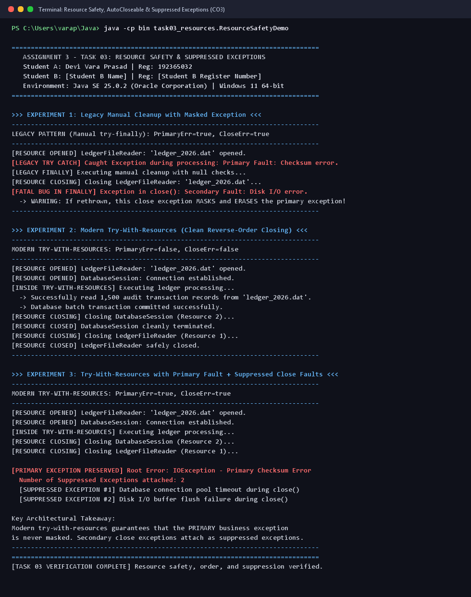

# Task 03: Resource Safety, AutoCloseable & Suppressed Exceptions

## Student Information
- **Student A**: Devi Vara Prasad | **Register Number**: 192365032
- **Student B**: [Student B Name] | **Register Number**: [Student B Register Number]
- **Course**: Programming in Java (CO3)
- **GitHub Repository**: [https://github.com/vara12126/Java](https://github.com/vara12126/Java)

---

## 1. Problem Overview
In enterprise banking applications, failure to properly close external resources (file descriptors, database connections, socket handles) leads to resource leaks, connection pool starvation, and application outages. 

This task implements:
1. **Legacy Manual `try-finally` Pattern**: Demonstrating the critical **Masked Exception Bug** where an exception thrown inside a `finally` block silently obliterates the primary business exception.
2. **Modern `try-with-resources` (`AutoCloseable`)**: Demonstrating deterministic resource management.
3. **Reverse-Order Closing (LIFO)**: Verifying that resources are automatically closed in the reverse order of declaration ($R_2 \to R_1$).
4. **Exception Suppression Mechanism**: Showing how secondary closing exceptions are attached to the primary exception using `Throwable.addSuppressed()` and retrieved via `Throwable.getSuppressed()`.

---

## 2. Directory Structure
```text
Task03_Resource_Safety/
├── src/
│   ├── DatabaseSession.java
│   ├── LedgerFileReader.java
│   ├── ResourceSafetyDemo.java
│   └── GenerateTask03Screenshots.java
├── screenshots/
│   └── Task03_Resource_Safety.png
├── test-results/
│   └── Task03_Test_Results.txt
└── README.md
```

---

## 3. Key Concepts & Architecture

### A. The Masked Exception Problem (Pre-Java 7)
In legacy Java code, closing resources inside nested `finally` blocks suffers from exception masking:
```java
// Legacy Pattern
Resource res = null;
try {
    res = openResource();
    res.process(); // Throws Exception A (e.g. Checksum Failure)
} finally {
    if (res != null) {
        res.close(); // Throws Exception B (e.g. Socket Error)
    }
}
// RESULT: Exception A is silently DISCARDED. Only Exception B propagates!
```
The developer sees only the generic closing error, losing all debugging visibility into the root cause.

### B. Modern Try-with-Resources & Suppressed Exceptions (Java 7+)
```java
try (LedgerFileReader reader = new LedgerFileReader(...);
     DatabaseSession db = new DatabaseSession(...)) {
    reader.readLedgerRecord(true); // Primary Exception A
} catch (Exception e) {
    // Exception A is preserved!
    // Exception B and C from close() are attached as suppressed:
    for (Throwable t : e.getSuppressed()) {
        System.out.println("Suppressed: " + t.getMessage());
    }
}
```

### C. Resource Destruction Order (LIFO)
Resources declared in the try-header are closed in reverse order:
1. `Resource 1: LedgerFileReader` opened first.
2. `Resource 2: DatabaseSession` opened second.
3. Upon block exit, `DatabaseSession` is closed **first**.
4. Then `LedgerFileReader` is closed **second**.

---

## 4. Execution Evidence & Screenshots

### Terminal Screenshot


---

## 5. How to Compile and Run

```bash
# Compile from repository root
javac -d bin Assignment\ 3/Task03_Resource_Safety/src/*.java Assignment\ 3/Report/*.java

# Run demonstration
java -cp bin task03_resources.ResourceSafetyDemo

# Regenerate screenshots
java -cp bin task03_resources.GenerateTask03Screenshots
```

---

## 6. Pair Work Distribution
- **Student A (Devi Vara Prasad, 192365032)**: Designed `LedgerFileReader` and `DatabaseSession` with `AutoCloseable` contract, designed legacy masked exception experiment, and implemented screenshot capture automation.
- **Student B ([Student B Name], [Student B Register Number])**: Implemented suppressed exception parsing and retrieval, verified reverse-order LIFO closing sequence, and documented comparative complexity analysis.
