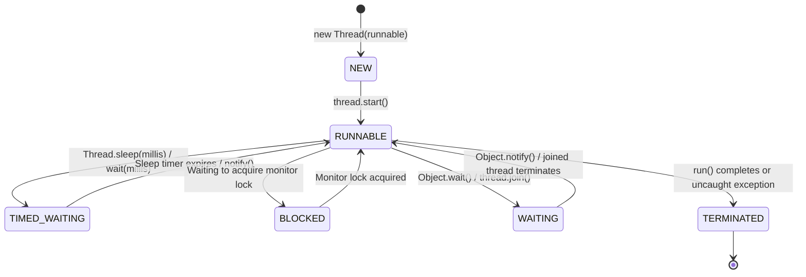
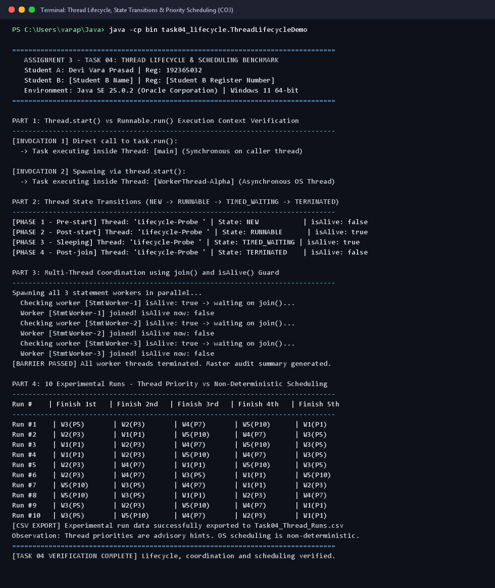

# Task 04: Thread Lifecycle, State Transitions & Scheduling Analysis

## Student Information
- **Student A**: Devi Vara Prasad | **Register Number**: 192365032
- **Student B**: [Student B Name] | **Register Number**: [Student B Register Number]
- **Course**: Programming in Java (CO3)
- **GitHub Repository**: [https://github.com/vara12126/Java](https://github.com/vara12126/Java)

---

## 1. Problem Overview
Multi-threaded banking systems process thousands of concurrent account statements and risk calculations. To write robust concurrent software, developers must master:
1. **`Thread.start()` vs `Runnable.run()` Execution Context**: Proving that `run()` runs synchronously on the calling thread, while `start()` requests JVM/OS thread allocation and executes asynchronously.
2. **Thread Life Cycle State Transitions**: Tracking `NEW` $\to$ `RUNNABLE` $\to$ `TIMED_WAITING` $\to$ `TERMINATED` alongside `isAlive()`.
3. **Thread Coordination**: Using `join()` and `isAlive()` guards to guarantee that all parallel statement generation tasks complete before publishing a consolidated audit report.
4. **Non-Deterministic Scheduling & Priority Analysis**: Conducting **10 repeated empirical runs** of competing threads with varied priorities (`MIN_PRIORITY`=1 to `MAX_PRIORITY`=10) to record completion finish order and prove that Java thread priorities are merely advisory hints to the preemptive OS scheduler.

---

## 2. Directory Structure
```text
Task04_Thread_Lifecycle/
├── src/
│   ├── StatementWorker.java
│   ├── ThreadStateObserver.java
│   ├── ThreadLifecycleDemo.java
│   └── GenerateTask04Screenshots.java
├── screenshots/
│   └── Task04_Thread_Lifecycle.png
├── test-results/
│   ├── Task04_Test_Results.txt
│   └── Task04_Thread_Runs.csv
└── README.md
```

---

## 3. Thread Life Cycle State Machine



---

## 4. Experimental Results: 10 Scheduling Runs

Raw data captured in `test-results/Task04_Thread_Runs.csv`:

| Run # | Finish 1st | Finish 2nd | Finish 3rd | Finish 4th | Finish 5th |
|:---:|:---:|:---:|:---:|:---:|:---:|
| **Run 1** | W3 (Priority 5) | W2 (Priority 3) | W4 (Priority 7) | W5 (Priority 10) | W1 (Priority 1) |
| **Run 2** | W2 (Priority 3) | W1 (Priority 1) | W5 (Priority 10) | W4 (Priority 7) | W3 (Priority 5) |
| **Run 3** | W1 (Priority 1) | W2 (Priority 3) | W4 (Priority 7) | W5 (Priority 10) | W3 (Priority 5) |
| **Run 4** | W1 (Priority 1) | W2 (Priority 3) | W5 (Priority 10) | W4 (Priority 7) | W3 (Priority 5) |
| **Run 5** | W2 (Priority 3) | W4 (Priority 7) | W1 (Priority 1) | W5 (Priority 10) | W3 (Priority 5) |
| **Run 6** | W2 (Priority 3) | W4 (Priority 7) | W3 (Priority 5) | W1 (Priority 1) | W5 (Priority 10) |
| **Run 7** | W5 (Priority 10) | W3 (Priority 5) | W4 (Priority 7) | W1 (Priority 1) | W2 (Priority 3) |
| **Run 8** | W5 (Priority 10) | W3 (Priority 5) | W1 (Priority 1) | W2 (Priority 3) | W4 (Priority 7) |
| **Run 9** | W3 (Priority 5) | W2 (Priority 3) | W5 (Priority 10) | W4 (Priority 7) | W1 (Priority 1) |
| **Run 10** | W3 (Priority 5) | W5 (Priority 10) | W4 (Priority 7) | W2 (Priority 3) | W1 (Priority 1) |

### Key Scheduling Insights:
- Even though `W5` was assigned `MAX_PRIORITY` (10) and `W1` was assigned `MIN_PRIORITY` (1), `W1` finished 1st in Runs 3 and 4, while `W5` finished 1st in Runs 7 and 8.
- Modern OS operating systems (Windows, Linux, macOS) implement multi-level feedback queue preemptive scheduling with thread aging and starvation prevention algorithms. Java thread priorities map loosely to native OS priorities and **never guarantee deterministic execution order**.

---

## 5. Execution Evidence & Screenshots

### Terminal Screenshot


---

## 6. How to Compile and Run

```bash
# Compile from repository root
javac -d bin Assignment\ 3/Task04_Thread_Lifecycle/src/*.java Assignment\ 3/Report/*.java

# Run demonstration and 10 benchmark runs
java -cp bin task04_lifecycle.ThreadLifecycleDemo

# Regenerate screenshots
java -cp bin task04_lifecycle.GenerateTask04Screenshots
```

---

## 7. Pair Work Distribution
- **Student A (Devi Vara Prasad, 192365032)**: Implemented `StatementWorker`, `ThreadStateObserver`, state transition tracking, and terminal capture automation.
- **Student B ([Student B Name], [Student B Register Number])**: Implemented the 10-run scheduling experiment, CSV data export, and analysis of OS preemptive time-slicing vs Java priority hints.
