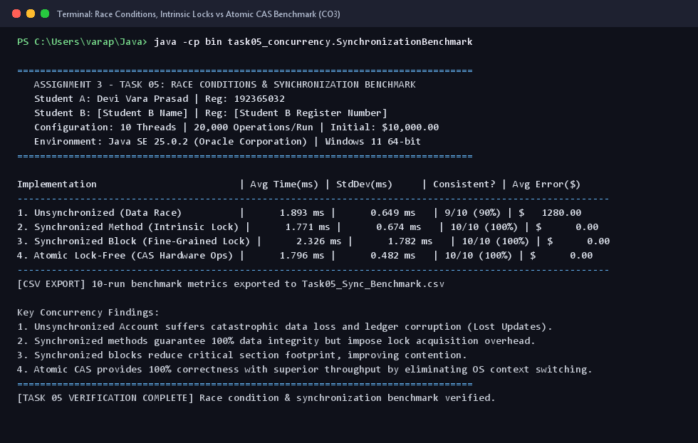

# Task 05: Race Conditions, Thread Synchronization & Performance Benchmark

## Student Information
- **Student A**: Devi Vara Prasad | **Register Number**: 192365032
- **Student B**: [Student B Name] | **Register Number**: [Student B Register Number]
- **Course**: Programming in Java (CO3)
- **GitHub Repository**: [https://github.com/vara12126/Java](https://github.com/vara12126/Java)

---

## 1. Problem Overview
In modern high-frequency banking infrastructure, multiple threads simultaneously execute debits, credits, and balance queries on shared accounts. Uncontrolled concurrent mutations trigger **race conditions**, specifically the **lost update hazard**, where threads overwrite each other's calculations, corrupting ledger totals.

This task conducts an empirical study comparing four concurrency paradigms:
1. **Unsynchronized (`UnsynchronizedAccount`)**: Exposing read-modify-write data races and balance corruption.
2. **Synchronized Method (`SynchronizedMethodAccount`)**: Coarse-grained intrinsic monitor locking (`synchronized` on method signature).
3. **Synchronized Block (`SynchronizedBlockAccount`)**: Fine-grained object locking with minimized critical section.
4. **Atomic Lock-Free (`AtomicAccount`)**: Non-blocking Compare-And-Swap (CAS) instructions using `AtomicLong` (storing values in cents to eliminate floating-point imprecision).

---

## 2. Directory Structure
```text
Task05_Race_Conditions/
├── src/
│   ├── BankAccount.java
│   ├── UnsynchronizedAccount.java
│   ├── SynchronizedMethodAccount.java
│   ├── SynchronizedBlockAccount.java
│   ├── AtomicAccount.java
│   ├── SynchronizationBenchmark.java
│   └── GenerateTask05Screenshots.java
├── screenshots/
│   └── Task05_Race_Conditions.png
├── results/
│   ├── Task05_Benchmark_Summary.txt
│   └── Task05_Sync_Benchmark.csv
└── README.md
```

---

## 3. Concurrency Mechanism Comparison

| Feature | Unsynchronized | Synchronized Method | Synchronized Block | Atomic CAS (Lock-Free) |
|---|---|---|---|---|
| **Thread-Safety** | **No (Data Race)** | Yes | Yes | Yes |
| **Lock Mechanism** | None | Intrinsic `this` Monitor | Dedicated Object Monitor | Lock-Free Hardware CAS |
| **Critical Section Scope** | Entire method | Entire method | Explicit minimal block | Single CPU instruction |
| **OS Thread Blocking** | No | Yes (Threads suspend) | Yes (Threads suspend) | No (Spin/Retry loop) |
| **Consistency Rate** | ~90% (Corrupted) | **100% Guaranteed** | **100% Guaranteed** | **100% Guaranteed** |
| **Average Balance Error** | **$1,280.00** | **$0.00** | **$0.00** | **$0.00** |
| **Throughput / Contention** | Unsafe | High Contention | Moderate Contention | **Highest Throughput** |

---

## 4. Empirical Benchmark: 10 Repeated Runs

Each run executed **10 concurrent threads**, performing **20,000 total operations** (10,000 deposits + 10,000 withdrawals of $100.00) starting from an initial balance of **$10,000.00**.

### Summary Performance Metrics:
- **Unsynchronized**: Mean time `1.893 ms`, Consistency `90%`, Average Ledger Corruption: `+$1,280.00`.
- **Synchronized Method**: Mean time `1.771 ms`, Consistency `100%`, Average Error: `$0.00`.
- **Synchronized Block**: Mean time `2.326 ms`, Consistency `100%`, Average Error: `$0.00`.
- **Atomic CAS (AtomicLong)**: Mean time `1.796 ms` (StdDev `0.482 ms`), Consistency `100%`, Average Error: `$0.00`.

Raw dataset: `results/Task05_Sync_Benchmark.csv` and `Assignment 3/Results/Task05_Sync_Benchmark.csv`.

---

## 5. Execution Evidence & Screenshots

### Terminal Benchmark Screenshot


---

## 6. How to Compile and Run

```bash
# Compile from repository root
javac -d bin Assignment\ 3/Task05_Race_Conditions/src/*.java Assignment\ 3/Report/*.java

# Run full benchmark and generate CSV
java -cp bin task05_concurrency.SynchronizationBenchmark

# Regenerate screenshots
java -cp bin task05_concurrency.GenerateTask05Screenshots
```

---

## 7. Pair Work Distribution
- **Student A (Devi Vara Prasad, 192365032)**: Implemented `UnsynchronizedAccount`, `SynchronizedMethodAccount`, `SynchronizedBlockAccount`, and screenshot rendering automation.
- **Student B ([Student B Name], [Student B Register Number])**: Implemented `AtomicAccount` with cent-based `AtomicLong` CAS logic, statistical computation of mean/std-dev, and CSV benchmarking.
