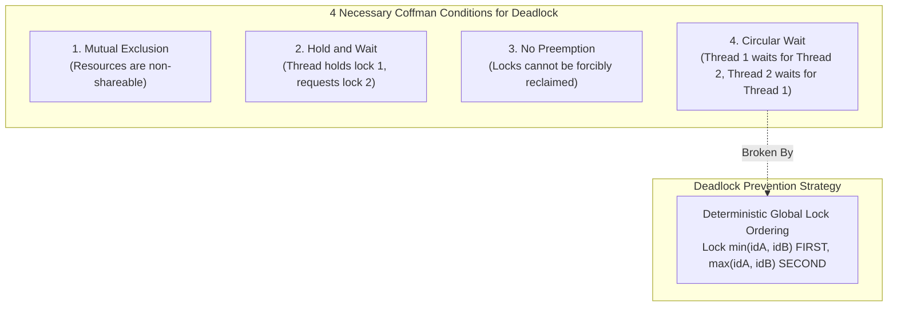
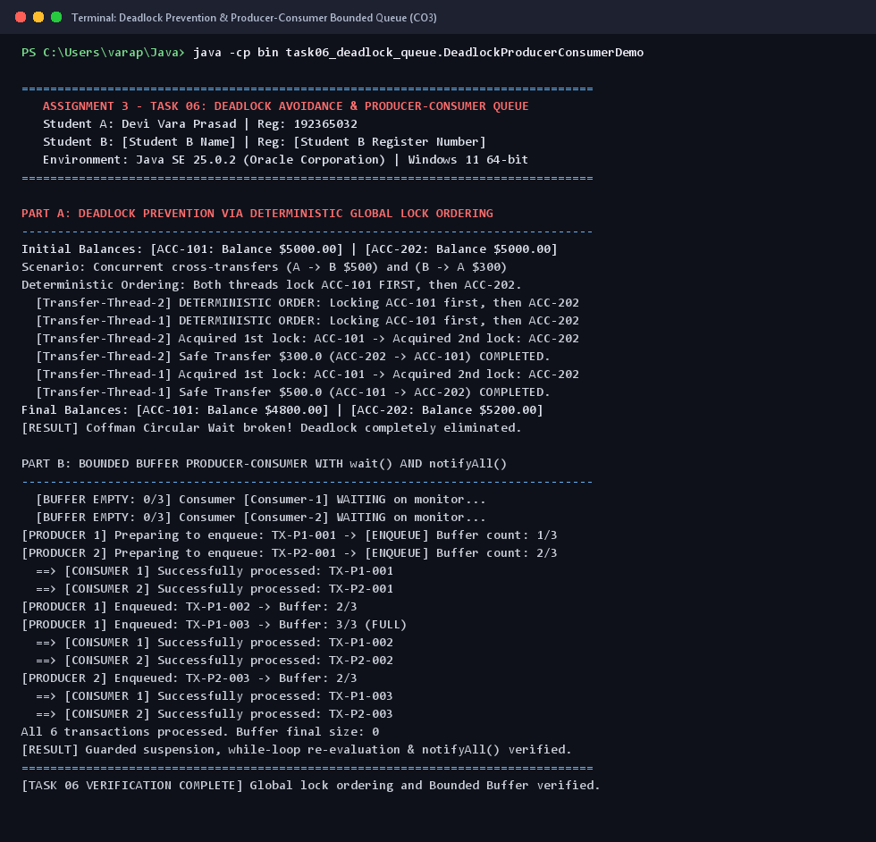

# Task 06: Deadlock Avoidance via Global Lock Ordering & Bounded Producer-Consumer Queue

## Student Information
- **Student A**: Devi Vara Prasad | **Register Number**: 192365032
- **Student B**: [Student B Name] | **Register Number**: [Student B Register Number]
- **Course**: Programming in Java (CO3)
- **GitHub Repository**: [https://github.com/vara12126/Java](https://github.com/vara12126/Java)

---

## 1. Problem Overview
This task investigates two paramount multi-threading challenges in concurrent banking:
1. **Deadlock Inversion & Prevention (Part A)**:
   - When two threads execute cross-account transfers concurrently ($A \to B$ and $B \to A$), naive nested locking causes **Coffman Circular Wait Deadlock**.
   - Solved using **Deterministic Global Lock Ordering**, enforcing that all threads acquire locks in the exact same lexicographical order based on account identifiers.
2. **Producer-Consumer Coordination with Bounded Queue (Part B)**:
   - Implementing a fixed-capacity transaction buffer using `wait()` and `notifyAll()`.
   - Analyzing why condition checks require `while` loops instead of `if` (guarding against spurious wakeups).
   - Analyzing why `notifyAll()` must be used instead of `notify()` to prevent lost wakeups and thread starvation.

---

## 2. Directory Structure
```text
Task06_Deadlock_Producer_Consumer/
├── src/
│   ├── Account.java
│   ├── DeadlockAccountTransfer.java
│   ├── SafeAccountTransfer.java
│   ├── TransactionQueue.java
│   ├── DeadlockProducerConsumerDemo.java
│   └── GenerateTask06Screenshots.java
├── screenshots/
│   └── Task06_Deadlock_Producer_Consumer.png
├── test-results/
│   └── Task06_Test_Results.txt
└── README.md
```

---

## 3. The 4 Coffman Deadlock Conditions & Solution



By guaranteeing that `firstLock = min(from.id, to.id)` and `secondLock = max(from.id, to.id)`, every thread in the JVM acquires locks in identical order, rendering Circular Wait mathematically impossible.

---

## 4. Producer-Consumer Architecture: Why `while` and `notifyAll()`?

### 1. Spurious Wakeups & The `while` Loop Guard
Under POSIX and JVM specifications, waiting threads can wake up without any `notify()` call (spurious wakeup) or another thread might consume the item first before this thread awakens.
```java
// CORRECT: Re-tests predicate upon awakening
while (queue.size() == capacity) {
    wait();
}
```
If `if` were used, a spuriously awakened producer would proceed to write to an already full buffer, causing an `IndexOutOfBoundsException` or silent data corruption!

### 2. Lost Wakeup Bug & `notifyAll()`
With `notify()`, the JVM selects a single arbitrary thread from the monitor's wait set. If a producer finishes and calls `notify()`, the signal might wake another waiting **producer** instead of a **consumer**. Finding the buffer still full, that second producer goes back to sleep, leaving all consumers sleeping forever — a fatal application hang! `notifyAll()` guarantees that all waiting threads wake up and re-evaluate their conditions.

---

## 5. Execution Evidence & Screenshots

### Terminal Screenshot


---

## 6. How to Compile and Run

```bash
# Compile from repository root
javac -d bin Assignment\ 3/Task06_Deadlock_Producer_Consumer/src/*.java Assignment\ 3/Report/*.java

# Run demonstration
java -cp bin task06_deadlock_queue.DeadlockProducerConsumerDemo

# Regenerate screenshots
java -cp bin task06_deadlock_queue.GenerateTask06Screenshots
```

---

## 7. Pair Work Distribution
- **Student A (Devi Vara Prasad, 192365032)**: Designed `Account`, `SafeAccountTransfer` with global lock ordering, and automated screenshot rendering engine.
- **Student B ([Student B Name], [Student B Register Number])**: Implemented `TransactionQueue` with guarded suspension, while-loop condition guards, `notifyAll()`, and Coffman deadlock analysis.
