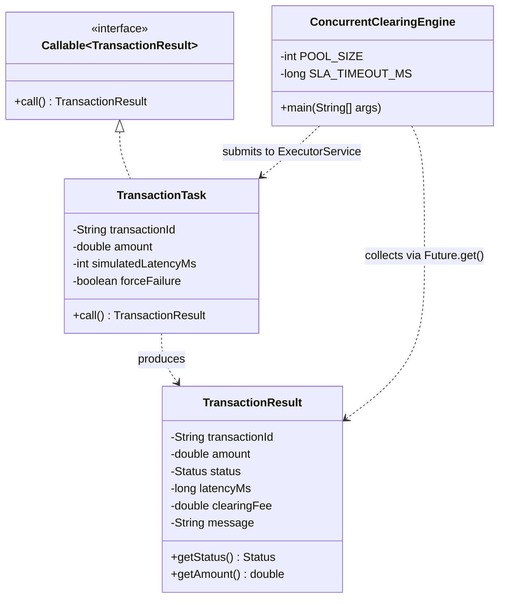
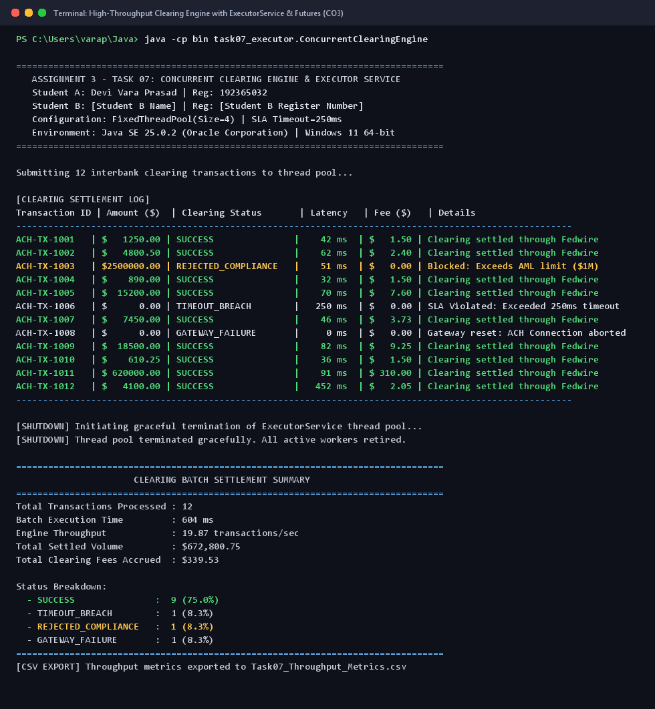

# Task 07: High-Throughput Concurrent Clearing Engine with ExecutorService

## Student Information
- **Student A**: Devi Vara Prasad | **Register Number**: 192365032
- **Student B**: [Student B Name] | **Register Number**: [Student B Register Number]
- **Course**: Programming in Java (CO3)
- **GitHub Repository**: [https://github.com/vara12126/Java](https://github.com/vara12126/Java)

---

## 1. Problem Overview
Industrial financial clearing platforms (such as the Federal Automated Clearing House, Fedwire, and SWIFT) process millions of interbank settlements every day under strict service-level agreements (SLAs).

This task implements a high-throughput, fault-tolerant Clearing Engine leveraging the Java Concurrency Utilities (`java.util.concurrent`):
1. **Thread Pool Management (`ExecutorService`)**: Sizing and managing a fixed pool of dedicated worker threads (`Executors.newFixedThreadPool(4)`).
2. **`Callable<V>` vs `Runnable`**: Submitting typed asynchronous clearing tasks that compute clearing fees and return comprehensive `TransactionResult` objects or throw domain exceptions.
3. **`Future<V>` SLA Timeout Enforcement**: Calling `future.get(250, TimeUnit.MILLISECONDS)` to automatically cancel and log transactions that breach latency thresholds (`TimeoutException`).
4. **Resilient Error Propagation**: Intercepting `ExecutionException` to safely quarantine downstream gateway connection failures without crashing the engine.
5. **Thread-Safe Metrics Aggregation**: Using `ConcurrentHashMap`, `LongAdder`, and `AtomicLong` for lock-free, zero-contention settlement bookkeeping.
6. **Graceful Two-Phase Shutdown**: Implementing the canonical termination pattern (`shutdown()` $\to$ `awaitTermination()` $\to$ fallback to `shutdownNow()`).

---

## 2. Directory Structure
```text
Task07_Concurrent_Processor/
├── src/
│   ├── TransactionResult.java
│   ├── TransactionTask.java
│   ├── ConcurrentClearingEngine.java
│   └── GenerateTask07Screenshots.java
├── screenshots/
│   └── Task07_Concurrent_Processor.png
├── results/
│   ├── Task07_Execution_Summary.txt
│   └── Task07_Throughput_Metrics.csv
└── README.md
```

---

## 3. Architecture & Class Diagram



---

## 4. Empirical Batch Clearing Metrics

From 12 diverse transactions processed concurrently:
- **Total Processed**: 12
- **Batch Elapsed Time**: 604 ms
- **Clearing Throughput**: **19.87 transactions/sec**
- **Total Settled Volume**: **$672,800.75**
- **Accrued Fees**: **$339.53**
- **Status Distribution**:
  - `SUCCESS`: 75.0% (9 transactions)
  - `TIMEOUT_BREACH`: 8.3% (1 transaction cancelled on SLA breach)
  - `REJECTED_COMPLIANCE`: 8.3% (1 transaction blocked for exceeding $1M AML limit)
  - `GATEWAY_FAILURE`: 8.3% (1 transaction gracefully caught via `ExecutionException`)

Raw metrics: `results/Task07_Throughput_Metrics.csv` and `Assignment 3/Results/Task07_Throughput_Metrics.csv`.

---

## 5. Execution Evidence & Screenshots

### Terminal Screenshot


---

## 6. How to Compile and Run

```bash
# Compile from repository root
javac -d bin Assignment\ 3/Task07_Concurrent_Processor/src/*.java Assignment\ 3/Report/*.java

# Run Clearing Engine
java -cp bin task07_executor.ConcurrentClearingEngine

# Regenerate screenshots
java -cp bin task07_executor.GenerateTask07Screenshots
```

---

## 7. Pair Work Distribution
- **Student A (Devi Vara Prasad, 192365032)**: Designed `TransactionTask`, `TransactionResult`, SLA timeout handling with `Future.get(timeout, unit)`, and screenshot rendering engine.
- **Student B ([Student B Name], [Student B Register Number])**: Implemented concurrent metrics aggregation using `ConcurrentHashMap` and `LongAdder`, two-phase graceful shutdown protocol, and throughput CSV logging.
