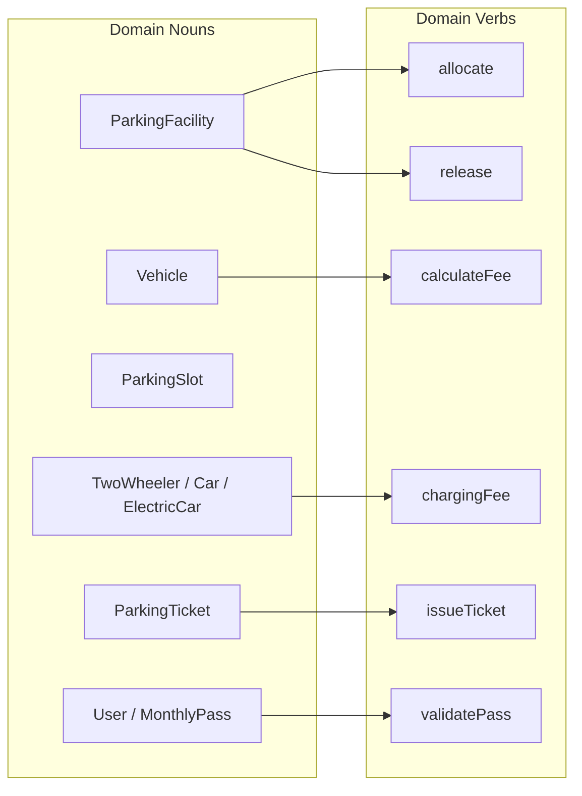

# Task 01 – Understand the Problem and Identify the Objects

**Course Outcome:** CO1 – Java fundamentals and object-oriented programming  
**Bloom's Level:** K4 (Analyse)  
**Student Name:** Kattiripalli Dhanush  
**Register Number:** 192311094  

---

## 1. Problem Analysis & Domain Overview

The university campus operates a multi-level smart-parking facility catering to three major user groups: **students**, **faculty/staff**, and **visitors**. The parking infrastructure spans multiple floors, where each floor contains a predetermined number of designated slots. Vehicles entering the campus fall into distinct categories:
- **Two-Wheelers** (motorcycles, scooters)
- **Cars** (standard 4-wheel passenger vehicles)
- **Electric Vehicles (EVs)** (which can use specialized charging points)

The system is responsible for automating:
1. **Entry Management:** Detecting incoming vehicles, finding and allocating an appropriate free parking slot, capturing entry timestamps, and issuing a unique, non-reusable parking ticket.
2. **Exit & Billing Management:** Verifying the parking ticket upon departure, freeing the occupied slot, calculating the parking duration (charging every started hour in full), applying user-specific fee waivers (e.g., free parking for valid monthly pass holders), computing EV charging costs if applicable, and generating a detailed receipt.

---

## 2. System Inputs and Outputs

### System Inputs
| Input Entity | Data Type | Description |
| :--- | :--- | :--- |
| **Registration Number** | `String` | Unique license plate number (e.g., `"TN01AB1111"`). |
| **Vehicle Category** | `String` / Type | Identifies vehicle kind (`TwoWheeler`, `Car`, `ElectricCar`). |
| **User Role / Pass Status** | `String` / `boolean` | Indicates whether the driver is Student/Staff with Monthly Pass, or Visitor. |
| **Entry Timestamp** | `LocalDateTime` / minutes | Exact time when the vehicle crossed the entry boom barrier. |
| **Exit Timestamp** | `LocalDateTime` / minutes | Exact time when the vehicle arrives at the exit booth. |
| **Energy Consumed (kWh)**| `int` / `double` | Units of electricity consumed if plugged into an EV charging slot. |

### System Outputs
| Output Entity | Data Type | Description |
| :--- | :--- | :--- |
| **Parking Ticket** | `ParkingTicket` object | Contains unique ticket ID, vehicle regNo, assigned floor & slot, and entry timestamp. |
| **Allocated Slot Coordinates** | `int[] {floor, slot}` | Identifies the physical slot assigned to the vehicle (e.g., `[0, 1]`). |
| **Parking Availability Status** | `boolean` / `int` | Real-time count of free slots per floor and overall facility status (`FULL` / `AVAILABLE`). |
| **Exit Billing Summary** | Receipt Text / `double` | Total parking duration (minutes & billable hours), base parking fee, charging fee, discount/pass waiver, and net payable amount. |

---

## 3. Noun-Verb Analysis

To model this system using pure Object-Oriented Principles, we identify domain entities using the **Noun-to-Class** and **Verb-to-Method** analysis technique:



### Nouns $\rightarrow$ Candidate Classes
1. **`Vehicle`** (Abstract superclass): Generalization representing any vehicle entering the facility.
2. **`TwoWheeler`** (Concrete subclass of `Vehicle`): Represents motorcycles and scooters.
3. **`Car`** (Concrete subclass of `Vehicle`): Represents four-wheeled passenger cars.
4. **`ElectricCar`** (Concrete subclass of `Car`): Represents EVs equipped for electrical charging.
5. **`ParkingSlot`**: Represents an individual parking space identified by floor number, slot number, and availability state.
6. **`ParkingFacility`**: The aggregate orchestrator managing floors, arrays of slots, and capacity.
7. **`ParkingTicket`**: An immutable transactional record issued upon entry and settled upon exit.
8. **`User` / `Pass`**: Represents the driver/user profile and pass privileges (monthly pass exemption).

### Verbs $\rightarrow$ Candidate Methods
1. **`allocate(Vehicle v)`**: Scans floors to find the first suitable vacant slot and parks the vehicle.
2. **`release(int floor, int slot)`**: Marks an occupied slot as vacant upon vehicle departure.
3. **`calculateFee(int minutes)`**: Computes the billable fee based on hourly tariffs and vehicle type.
4. **`chargingFee(int kWh)`**: Calculates EV battery charging fees based on consumed units.
5. **`issueTicket(Vehicle v, int floor, int slot)`**: Generates a ticket with an auto-incremented ID.
6. **`validatePass()`**: Checks whether the user holds an active pass exempting them from parking fees.

---

## 4. Responsibilities of Candidate Classes

Merely listing class names is insufficient; each class must have clear, high-cohesion responsibilities according to the **Single Responsibility Principle (SRP)**:

| Class Name | Primary Responsibility | Justification |
| :--- | :--- | :--- |
| **`Vehicle`** | Represents the core vehicle abstraction. Encapsulates vehicle registration number and defines the template for fee computation. | Common attributes like registration number must be centralized to prevent code duplication across specific vehicle types. |
| **`TwoWheeler`** | Implements specific business rules and tariff rates (Rs 10/hr) for two-wheelers. | Two-wheelers occupy smaller spaces and have lower hourly tariffs than cars. |
| **`Car`** | Implements standard passenger car tariff rates (Rs 30/hr). | Acts as the base class for four-wheelers and sets the standard car tariff. |
| **`ElectricCar`** | Extends `Car` and implements `Chargeable` to provide EV charging tariff (Rs 12/kWh). | Separation of concerns: only electric cars consume kWh and calculate charging surcharges. |
| **`ParkingSlot`** | Encapsulates the state of a single parking bay (`floor`, `slotNumber`, `isOccupied`, `parkedVehicle`). | Decouples physical slot state from the overall facility management logic. |
| **`ParkingFacility`** | Manages the multi-level grid of slots, coordinate bounds validation, allocation algorithms, and release operations. | High-level facility coordinator that controls floor occupancy and slot availability. |
| **`ParkingTicket`** | Holds transactional data for a single parking session (ticket ID, vehicle reference, entry timestamp, exit timestamp, slot coordinates). | Serves as an unalterable audit log and proof-of-parking for billing computation. |

---

## 5. Business Rules

Every valid operation in the Campus Smart-Parking System must strictly obey the following business invariants:

1. **Mutual Exclusion of Slots:** A parking slot cannot hold two vehicles at the same time. A slot must be marked occupied when allocated and can only be allocated again after being explicitly released.
2. **Unique, Non-Reusable Ticket ID:** Each issued ticket must have a globally unique identifier generated sequentially (e.g., via a static counter). Ticket IDs are never reset or reused during system runtime.
3. **Ceiling Billing Rule:** Every started hour is charged in full. For instance, a stay of 61 minutes must be billed for 2 full hours ($1\text{ hr } 1\text{ min} \rightarrow 2\text{ billable hours}$). Zero-minute or minimum stays are billed as 1 hour.
4. **Pass-Holder Fee Exemption:** Students and staff holding a validated monthly pass park free of charge for base parking, while visitors pay the full tariff.
5. **Dedicated EV Charging Tariffs:** Charging fees (Rs 12 per kWh) apply exclusively to electric vehicles plugged into charging points and are billed in addition to standard parking fees.
6. **No Duplicate Active Registrations:** The same vehicle cannot be admitted twice simultaneously if it is already recorded inside the facility.
7. **Coordinate Integrity:** Slot operations must be bounded by $0 \le \text{floor} < \text{totalFloors}$ and $0 \le \text{slot} < \text{slotsOnFloor}$. Invalid coordinate accesses must be safely rejected.

---

## 6. System Assumptions

1. **Floor & Slot Indexing:** Floors are zero-indexed ($0, 1, \dots, F-1$) and slot numbers within each floor start from $0$ up to $S_f - 1$.
2. **Operating Hours:** The system operates continuously (24/7). Time durations are calculated in minutes and converted to integer billable hours.
3. **Slot Sizing:** In the initial facility model, any standard slot can accommodate two-wheelers and cars; EV slots are equipped with charging points.
4. **Immediate Payment:** Visitors settle parking fees at the exit barrier upon ticket validation before the boom barrier opens.

---

## 7. Alternative Concept and Complexity Analysis

### Alternative: Storing Vehicles in Parallel Arrays
Instead of modeling vehicles as objects (`Vehicle`, `Car`, `ElectricCar`), an alternative procedural design stores vehicle data across multiple synchronized 1D arrays:
```java
String[] regNo = new String[CAPACITY];
String[] type = new String[CAPACITY];
long[] entryTime = new long[CAPACITY];
int[] assignedFloor = new int[CAPACITY];
int[] assignedSlot = new int[CAPACITY];
```

### Comparison Matrix

| Criterion | Object-Oriented Design (`Vehicle` & `ParkingTicket` objects) | Procedural Design (Parallel Arrays) |
| :--- | :--- | :--- |
| **Data Integrity & Cohesion** | **High.** All vehicle attributes are encapsulated within one cohesive object in the heap. | **Low.** Attributes are fragmented across multiple separate arrays. If an index shifts in one array without others, data becomes corrupted. |
| **Adding New Attributes** | **Trivial.** Simply add a field and getter in the class or a subclass (e.g., `batteryLevel` in `ElectricCar`). Existing client code remains untouched. | **Extremely Painful.** Requires declaring a new parallel array (`int[] batteryLevel = new int[CAPACITY]`), updating every method signature, and reallocating all arrays. |
| **Search Time by RegNo** | $O(N)$ linear scan over object array (or $O(1)$ with `HashMap<String, Vehicle>`). | $O(N)$ linear scan over `regNo[]`. |
| **Space Complexity per Vehicle** | ~40 to 64 bytes per object (including object header, field references, and padding). | Slightly fewer bytes per slot (~24 bytes of primitive array entries), but plagued by severe memory fragmentation and wasted capacity. |
| **Type Safety & Polymorphism** | **Strong.** Distinct vehicle types implement their own fee calculation polymorphically ($O(1)$ dispatch). | **Fragile.** Requires checking raw strings (e.g., `if (type[i].equals("CAR"))`) with error-prone `switch` or `if-else` blocks. |

### Conclusion on Task 1
The Object-Oriented design is vastly superior in modularity, type safety, maintainability, and extensibility. The object model cleanly encapsulates data and behavior, whereas parallel arrays violate encapsulation and easily lead to out-of-sync states.
