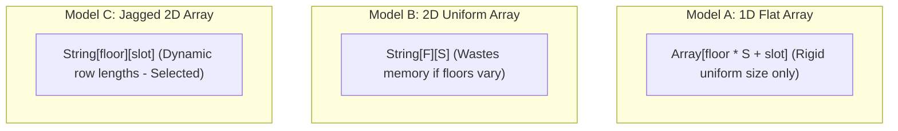

# Task 02 – Choose the Data Representation

**Course Outcome:** CO1 – Java fundamentals and object-oriented programming  
**Bloom's Level:** K4 (Analyse)  
**Student Name:** Kattiripalli Dhanush  
**Register Number:** 192311094  

---

## 1. Chosen Data Types and Justifications

To achieve both memory efficiency and numerical precision, data types are selected based on the domain characteristics of each field:

| Field Name | Java Data Type | Justification |
| :--- | :--- | :--- |
| **`slotNumber`** | `int` | Slots on a floor are indexed starting from $0$. The total number of slots per floor ($20$ to $100$) fits well within the 32-bit signed integer range ($-2^{31}$ to $2^{31}-1$). |
| **`floor`** | `int` | Campus facilities range from $1$ to $5$ floors. An `int` allows clean indexing in arrays without casting overhead. |
| **`vehicleNo` / `regNo`** | `String` | License plates contain alphanumeric characters, spaces, and regional codes (e.g., `"TN01AB1111"`), making `String` the only natural representation. |
| **`entryTime` / `exitTime`** | `long` / `int` (minutes) or `LocalTime` | In low-level billing algorithms, storing epoch minutes or minutes elapsed from midnight (`int`) allows fast, lightweight arithmetic. In enterprise domain models, `LocalDateTime` or `LocalTime` provides human-readable date/time handling. |
| **`duration` (minutes)** | `int` | The difference between exit and entry times in minutes. Parking durations rarely exceed several thousand minutes, which fits comfortably within an `int`. |
| **`billableHours`** | `int` | Parking tariffs are applied per hour. Since every started hour is billed in full, fractional hours are rounded up to the nearest whole integer. |
| **`fee` / `ratePerHour`**| `double` | Monetary amounts involve decimal currency (e.g., Rs 30.0, Rs 210.0) and multiplication with fractional rates. `double` provides 64-bit IEEE 754 precision, avoiding integer truncation. |
| **`isOccupied` / `isPassHolder`**| `boolean` | Binary flags represent state directly with minimal memory footprint and readable logical expressions. |

---

## 2. Representation of Floors and Slots

A campus multi-level facility requires representing a hierarchical structure: floors containing slots. There are three potential representation models:



### Why a Jagged Array (`String[][]` or `ParkingSlot[][]`) is Selected
1. **Variable Capacity per Floor:** In real-world university parking structures, the ground floor often has fewer slots due to entrance barriers, security booths, and EV charging infrastructure. Higher floors may have different layouts. A **jagged (ragged) array** allows each floor row to have its own independent length:
   ```java
   String[][] slots = new String[totalFloors][];
   for (int f = 0; f < totalFloors; f++) {
       slots[f] = new String[slotsPerFloor[f]];
   }
   ```
2. **Direct Intuitive Access:** Accessing a bay via `slots[floor][slot]` maps directly to the physical facility coordinates without complex arithmetic formulas.
3. **Memory Economy:** No memory is wasted allocating empty slots for floors that have smaller capacities.

---

## 3. Type Conversion, Casting, and the Integer Division Risk

### The Integer Division Trap
In Java, when two integer operands are divided using `/`, the JVM performs **truncation toward zero (floor division)**, discarding any fractional remainder.

Consider the billing rule: *"Every started hour is charged in full."*
If a vehicle parks for **65 minutes** at Rs 30.0/hr:
```java
// WRONG IMPLEMENTATION: Integer division truncates remainder!
int minutes = 65;
int wrongHours = minutes / 60; // 65 / 60 yields 1 (fraction 0.0833 is discarded)
double wrongFee = wrongHours * 30.0; // Produces Rs 30.0 instead of Rs 60.0!
```
**Consequence:** The university loses revenue on every vehicle that stays beyond an exact hour. A 61-minute stay and a 119-minute stay would both wrongly be billed for only 1 hour!

### Incorrect Cast Trap
Another common novice mistake is casting after division:
```java
// WRONG CAST: Division happens as integer first, then cast to double
double hours = (double) (minutes / 60); // (65 / 60) evaluates to 1, then cast to 1.0!
double wrongFee = Math.ceil(hours) * 30.0; // Still produces Rs 30.0!
```

### Safe Solutions Adopted in Our Design

#### Approach A: Pure Integer Ceiling Arithmetic (Recommended & Used in Task 3 & 8)
Using integer arithmetic avoids floating-point roundoff issues entirely:
```java
int billableHours = (minutes + 59) / 60;
double fee = billableHours * ratePerHour;
```
- For $1\text{ min}$: $(1 + 59) / 60 = 60 / 60 = 1\text{ hour}$
- For $60\text{ min}$: $(60 + 59) / 60 = 119 / 60 = 1\text{ hour}$
- For $61\text{ min}$: $(61 + 59) / 60 = 120 / 60 = 2\text{ hours}$
- For $120\text{ min}$: $(120 + 59) / 60 = 179 / 60 = 2\text{ hours}$
- For $130\text{ min}$: $(130 + 59) / 60 = 189 / 60 = 3\text{ hours}$

#### Approach B: Floating-Point Math with `Math.ceil()`
```java
int billableHours = (int) Math.ceil((double) minutes / 60.0);
```

Both correctly prevent revenue leakage.

---

## 4. Reading Input: Scanner vs Command-Line Arguments

The system utilizes both input mechanisms depending on the operating context:
1. **Command-Line Arguments (`String[] args`):**
   - Ideal for initialization parameters, facility dimensions, or automated batch testing (e.g., passing `new int[]{2, 1}` to configure floor capacities).
   - Fast, non-blocking, and scriptable.
2. **`java.util.Scanner`:**
   - Ideal for interactive console-based kiosk testing where a parking attendant manually enters vehicle numbers, vehicle types, and charging requirements.
   - Requires robust input validation (e.g., checking `scanner.hasNextInt()` to prevent `InputMismatchException`).

---

## 5. Alternative Concept and Complexity Analysis

### Comparison of Storage Representations

| Metric | Jagged 2D Array `String[floor][slot]` | 1D Flat Array `String[floor * S + slot]` | Dynamic `ArrayList<String[]>` |
| :--- | :--- | :--- | :--- |
| **Locating a Slot by Coordinates `(f, s)`** | $O(1)$ constant time (row pointer dereference + offset). | $O(1)$ constant time ($f \times S + s$). **Fails if floor capacities vary!** | $O(1)$ constant time (`list.get(f)[s]`). |
| **Variable Slot Counts per Floor** | **Naturally supported.** Each row array has its own `length`. | **Requires prefix-sum array** $\text{offset}[f] + s$, adding extra memory and logic. | **Naturally supported.** Each element is an array of variable length. |
| **Memory Footprint** | $F$ row references + $\sum S_f$ references. Minimal heap overhead. | $1$ flat array object holding $\sum S_f$ references. Most compact memory layout. | 1 `ArrayList` wrapper object + internal array of object references + row arrays. Highest memory overhead. |
| **Cache Locality** | Good per row; separate rows are independent heap objects. | Excellent (contiguous memory block). | Moderate (pointer indirection through `ArrayList` backing array). |

### Complexity Breakdown
- **Time Complexity to Access `(floor, slot)`:**
  - Jagged Array: $T(1) = O(1)$
  - 1D Flat Array: $T(1) = O(1)$ (with uniform floors)
  - ArrayList: $T(1) = O(1)$
- **Space Complexity:**
  - All three representations require $O(\sum_{f=0}^{F-1} S_f)$ references. The jagged array provides the best balance between simplicity, memory efficiency, and native support for irregular floor plans.
