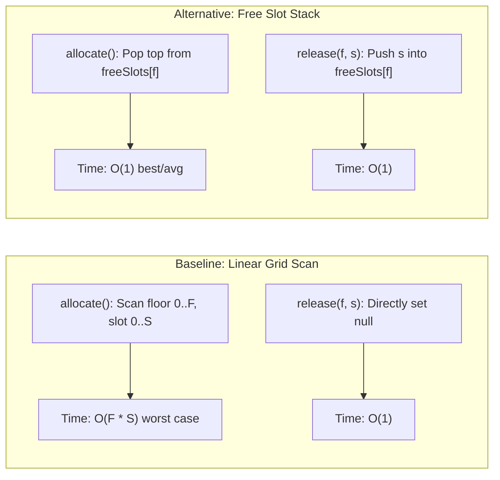

# Task 03 – Design the Control Logic

**Course Outcome:** CO1 – Java fundamentals and object-oriented programming  
**Bloom's Level:** K4 (Analyse)  
**Student Name:** Kattiripalli Dhanush  
**Register Number:** 192311094  

---

## 1. Control Logic Design for Core Operations

In a parking management system, high throughput and zero data corruption depend directly on the efficiency of two critical operations:
1. **Slot Allocation (`allocate`):** Finding an empty bay and recording the vehicle.
2. **Fee Computation (`calculateFee`):** Calculating the fee based on vehicle category, duration, and billing rules.

---

## 2. Searching Floors and Slots

### Search Strategy
The allocation algorithm follows a **First-Fit Search** strategy across a 2D jagged array `slots[floor][slot]`:
- An outer loop iterates sequentially through floors from lowest ($f = 0$) to highest ($f = \text{totalFloors} - 1$). This prioritizes filling lower floors first, minimizing customer driving time and congestion.
- An inner loop scans slots on that floor from index $s = 0$ to $s = \text{slots}[f].\text{length} - 1$.
- At each cell, it checks `if (slots[f][s] == null)`.

### When the Search Stops
The search terminates immediately via a **short-circuit `return` statement** as soon as the first `null` (vacant) slot is found. It assigns `slots[f][s] = vehicleNo` and returns `{f, s}`.
If the nested loops run to completion without finding any vacant slot, the method returns `null`, indicating the facility is completely full.

---

## 3. Expressing Fee Slabs using Decision Structures

Parking systems frequently enforce tiered pricing (fee slabs) to prevent overnight hogging while keeping short campus visits affordable.

### Example Slabs:
- **First hour:** Base rate (e.g., Rs 30 for cars).
- **Each additional hour:** Incremental rate (e.g., Rs 20/hr).
- **Daily Cap / Maximum:** Rs 200 per 24-hour cycle.
- **Pass Holders:** Rs 0 (100% waiver).

### Decision Structure
Using structured `if-else` branching:
```java
public double computeSlabFee(int minutes, boolean isPassHolder, double hourlyRate) {
    if (isPassHolder) {
        return 0.0; // Immediate exit for authorized pass holders
    }
    
    int hours = (minutes + 59) / 60; // Ceiling billing rule
    if (hours <= 0) {
        hours = 1; // Minimum charge is 1 hour
    }
    
    double totalFee;
    if (hours == 1) {
        totalFee = hourlyRate; // 1st hour base rate
    } else if (hours <= 8) {
        totalFee = hourlyRate + (hours - 1) * (hourlyRate * 0.75); // Tiered additional hours
    } else {
        totalFee = Math.min(hourlyRate + (hours - 1) * (hourlyRate * 0.75), 200.0); // Daily ceiling cap
    }
    return totalFee;
}
```

---

## 4. Use of `break`, `continue`, and `return` to Avoid Unnecessary Work

Control transfer statements prevent redundant CPU cycles:
1. **`return` in `allocate()`:** 
   Immediately upon placing a vehicle into `slots[f][s]`, executing `return new int[]{f, s};` terminates both inner and outer loops without needing boolean flags or checking remaining floors.
2. **`continue` in Multi-Category Allocation:**
   If a particular floor is reserved exclusively for Two-Wheelers and the incoming vehicle is a Car, a `continue;` statement immediately skips scanning that floor's slots.
3. **`break` in Existence Checks:**
   When searching for whether a vehicle registration already exists in the lot, `break;` terminates loop execution immediately once a match is found.

---

## 5. What Happens When No Suitable Slot is Free

When the entire facility is occupied:
1. `allocate()` completes its iteration over all floors and slots and returns `null`.
2. The caller checks `if (allocatedCoords == null)` and gracefully displays:
   `"Facility Full! Please wait at the entrance barrier."`
3. No internal state is corrupted, and no `ArrayIndexOutOfBoundsException` or `NullPointerException` is thrown.

---

## 6. Algorithmic Pseudocode (SIMATS Engineering Standard)

### Operation 1: Slot Allocation Algorithm
```text
ALGORITHM AllocateSlot(slots[][], vehicleNo)
    INPUT: slots[][] as 2D Array of Strings, vehicleNo as String
    OUTPUT: Array of 2 integers {floor, slot} or NULL if facility is full

    BEGIN
        IF vehicleNo IS NULL OR vehicleNo IS EMPTY THEN
            RETURN NULL
        ENDIF

        FOR f <- 0 TO LENGTH(slots) - 1 STEP 1 DO
            FOR s <- 0 TO LENGTH(slots[f]) - 1 STEP 1 DO
                IF slots[f][s] IS NULL THEN
                    slots[f][s] <- vehicleNo
                    RETURN ARRAY{f, s}
                ENDIF
            ENDFOR
        ENDFOR

        RETURN NULL
    END
```

### Operation 2: Fee Computation Algorithm
```text
ALGORITHM ComputeParkingFee(vehicleType, minutes, hasMonthlyPass, isCharging, kWh)
    INPUT: vehicleType as String, minutes as Integer, hasMonthlyPass as Boolean,
           isCharging as Boolean, kWh as Integer
    OUTPUT: totalFee as Double

    BEGIN
        IF hasMonthlyPass IS TRUE THEN
            totalFee <- 0.0
        ELSE
            hours <- (minutes + 59) / 60
            IF hours <= 0 THEN
                hours <- 1
            ENDIF

            ratePerHour <- 0.0
            SWITCH vehicleType DO
                CASE "TwoWheeler":
                    ratePerHour <- 10.0
                CASE "Car":
                    ratePerHour <- 30.0
                CASE "ElectricCar":
                    ratePerHour <- 30.0
                DEFAULT:
                    ratePerHour <- 20.0
            ENDSWITCH

            totalFee <- hours * ratePerHour
        ENDIF

        IF isCharging IS TRUE AND kWh > 0 THEN
            chargingCost <- kWh * 12.0
            totalFee <- totalFee + chargingCost
        ENDIF

        RETURN totalFee
    END
```

---

## 7. Alternative Concept and Complexity Analysis

### Comparison: Linear Grid Scan vs Stack/Queue of Free Slots per Floor

In the baseline design, allocation scans through the 2D array until it encounters a `null` cell.
In the alternative design, the facility maintains:
1. An integer array `freeCount[F]` holding the count of available bays per floor.
2. An array of Stacks `Stack<Integer>[] freeSlots = new Stack[F]` storing the available slot indices for each floor.



### Detailed Complexity Analysis

| Operation | Baseline 2D Grid Scan | Alternative: Stack of Free Slots |
| :--- | :--- | :--- |
| **`allocate()` Time Complexity** | **Worst Case:** $O(F \times S)$ when facility is full or near-full.<br>**Best Case:** $O(1)$ when `slots[0][0]` is free. | **Worst Case:** $O(F)$ to find the first non-empty stack.<br>**Average Case:** $O(1)$ constant time `pop()`. |
| **`release()` Time Complexity** | $O(1)$ constant time (validates bounds and sets `slots[f][s] = null`). | $O(1)$ constant time (sets slot null and `push(s)` to stack). |
| **Extra Auxiliary Space** | **$O(1)$ extra space.** Only the existing `slots[][]` array is used. | **$O(F \times S)$ extra space.** Up to $F \times S$ integer references stored across $F$ stack data structures, plus $O(F)$ for count array. |
| **Complexity Trade-off** | Simple, robust, zero extra memory overhead; perfectly acceptable for small to medium campuses ($F \le 5, S \le 100 \implies 500$ operations max, sub-microsecond). | Ideal for ultra-large commercial airports ($10,000+$ slots) where scanning array causes latency spikes. |
