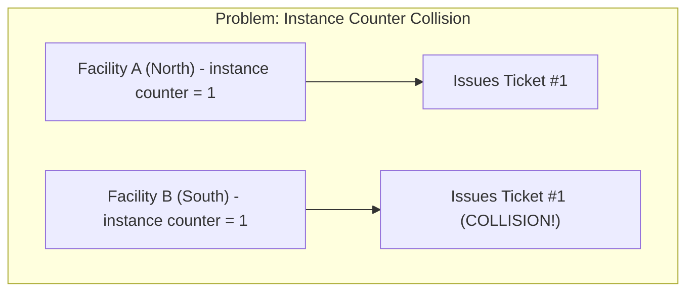

# Task 05 – Apply static Members and the Object Life Cycle

**Course Outcome:** CO1 – Java fundamentals and object-oriented programming  
**Bloom's Level:** K4 (Analyse)  
**Student Name:** Kattiripalli Dhanush  
**Register Number:** 192311094  

---

## 1. Static Variables vs Instance Variables

In Java, **instance variables** belong to a specific object instance on the heap; every newly instantiated object gets its own private copy. In contrast, **static variables (class variables)** belong to the class itself, stored in the JVM Metaspace/Class area, shared by all instances of that class.

```text
    JVM METASPACE / CLASS AREA                     HEAP MEMORY
 +-------------------------------+      +--------------------------------+
 | Class: ParkingTicket          |      | Ticket #1001                   |
 |  static int ticketCounter=1003|      |  ticketId: 1001, regNo: TN01   |
 +-------------------------------+      +--------------------------------+
                 |
                 +--------------------->+--------------------------------+
                 |                      | Ticket #1002                   |
                 |                      |  ticketId: 1002, regNo: TN02   |
                 |                      +--------------------------------+
                 +--------------------->+--------------------------------+
                                        | Ticket #1003                   |
                                        |  ticketId: 1003, regNo: TN03   |
                                        +--------------------------------+
```

### Where Static Variables are Essential:
1. **Global Sequential Ticket Counter (`static int ticketCounter = 1000`):**
   - Each issued ticket must have a globally unique serial number.
   - **Why an instance variable would be wrong:** If `ticketCounter` were an instance variable, every newly created `new ParkingTicket()` object would initialize its own counter to $1000$. Every vehicle would receive Ticket #1000, causing massive collisions, audit failures, and inability to uniquely reference a vehicle during exit billing.
2. **Total Facility Occupancy (`static int globalVehiclesParked`):**
   - Tracks campus-wide parking loads across multiple gates.
3. **Standard Tariffs / System Constants:**
   - E.g., `public static final double EV_CHARGING_RATE_PER_KWH = 12.0;`

---

## 2. Static Methods and Static Blocks

### Static Methods
Methods declared with `static` execute in the class context without requiring an object instance (`ClassName.methodName()`).
- **Use Cases in our design:**
  - `ParkingTicket.getNextTicketNumber()`: Returns the current ticket counter.
  - Utility validation methods: `public static boolean isValidRegNo(String regNo)`.
  - Factory methods: `ParkingFacility.createStandardCampusFacility()`.
- **Constraint:** Static methods cannot directly access instance fields or call instance methods (`this` does not exist in static context).

### Static Initialization Blocks
Executed exactly once when the class is loaded into memory by the ClassLoader, prior to any constructors:
```java
public class ParkingFacility {
    public static final Map<String, Double> BASE_RATES = new HashMap<>();
    static {
        // Complex static initialization
        BASE_RATES.put("TwoWheeler", 10.0);
        BASE_RATES.put("Car", 30.0);
        BASE_RATES.put("ElectricCar", 30.0);
    }
}
```

---

## 3. Object Life Cycle and Garbage Collection (GC)

An object in Java progresses through four lifecycle stages:
1. **Creation:** Memory allocated on heap via `new`; constructor initializes fields.
2. **In-Use (Reachable):** Held by active references (e.g., stored in `slots[][]` or `activeTickets` map).
3. **Unreachable (Eligible for GC):** When the vehicle departs, the system clears references:
   ```java
   slots[floor][slot] = null; // Reference removed
   activeTicket = null;       // Local reference goes out of scope
   ```
4. **Reclamation:** The Garbage Collector (e.g., G1GC / ZGC) sweeps the heap, detects objects with no live incoming reference paths from GC Roots (thread stack frames, static variables), and frees their memory.

---

## 4. Object Passing and Returning Mechanics

Java is strictly **pass-by-value**:
- For primitive types (`int`, `double`), a copy of the actual binary value is passed.
- For object references (`Vehicle v`, `ParkingTicket t`), **a copy of the reference pointer** (memory address) is passed by value.
- **Consequence:** If a method mutates the internal state of the passed object (`ticket.markPaid()`), the change reflects in the caller because both reference copies point to the same object in the heap. However, reassigning the parameter reference (`v = new Car(...)`) inside the method does *not* reassign the caller's variable.

---

## 5. Alternative Concept and Complexity Analysis

### Scenario: Ticket Counter as Instance Variable in a Multi-Facility Campus (North & South Gates)

Suppose the university establishes two independent facilities: **North Gate Facility** and **South Gate Facility**.



### Analysis of Solutions

#### Approach 1: Global JVM Static Counter
A single `static int ticketCounter` shared by all facilities.
- **Behavior:** North Gate issues Ticket 101, South Gate issues Ticket 102, North Gate issues Ticket 103.
- **Pro:** Guaranteed uniqueness across the entire university.
- **Space Complexity:** $O(1)$ space (a single 4-byte integer in Metaspace/Class area regardless of $k$ facilities and $n$ tickets).

#### Approach 2: Facility Instance Counter with Prefixing
Each facility instance maintains its own `private int localTicketCounter` and prefixes the ID with its unique facility code:
- **Behavior:** North Gate issues `"NORTH-001"`, `"NORTH-002"`; South Gate issues `"SOUTH-001"`, `"SOUTH-002"`.
- **Pro:** Facilities can operate autonomously without cross-facility locks/synchronization bottlenecks.
- **Space Complexity:** $O(k)$ space for $k$ facility instances ($k$ integers in heap).

### Comparison Matrix for $k$ Facilities and $n$ Tickets

| Dimension | Global Static Counter | Instance Counter (Unprefixed) | Prefixed Instance Counter |
| :--- | :--- | :--- | :--- |
| **Collision Risk** | **Zero.** Uniform sequence. | **Catastrophic.** Duplicate IDs issued across gates. | **Zero.** Namespaced by facility prefix. |
| **Space Complexity** | $O(1)$ static storage. | $O(k)$ for $k$ facility objects. | $O(k)$ for $k$ facility objects. |
| **Distributed / Multi-Gate Suitability** | High for single-campus unified database. | Unusable. | Excellent for multi-threaded, federated gates. |
