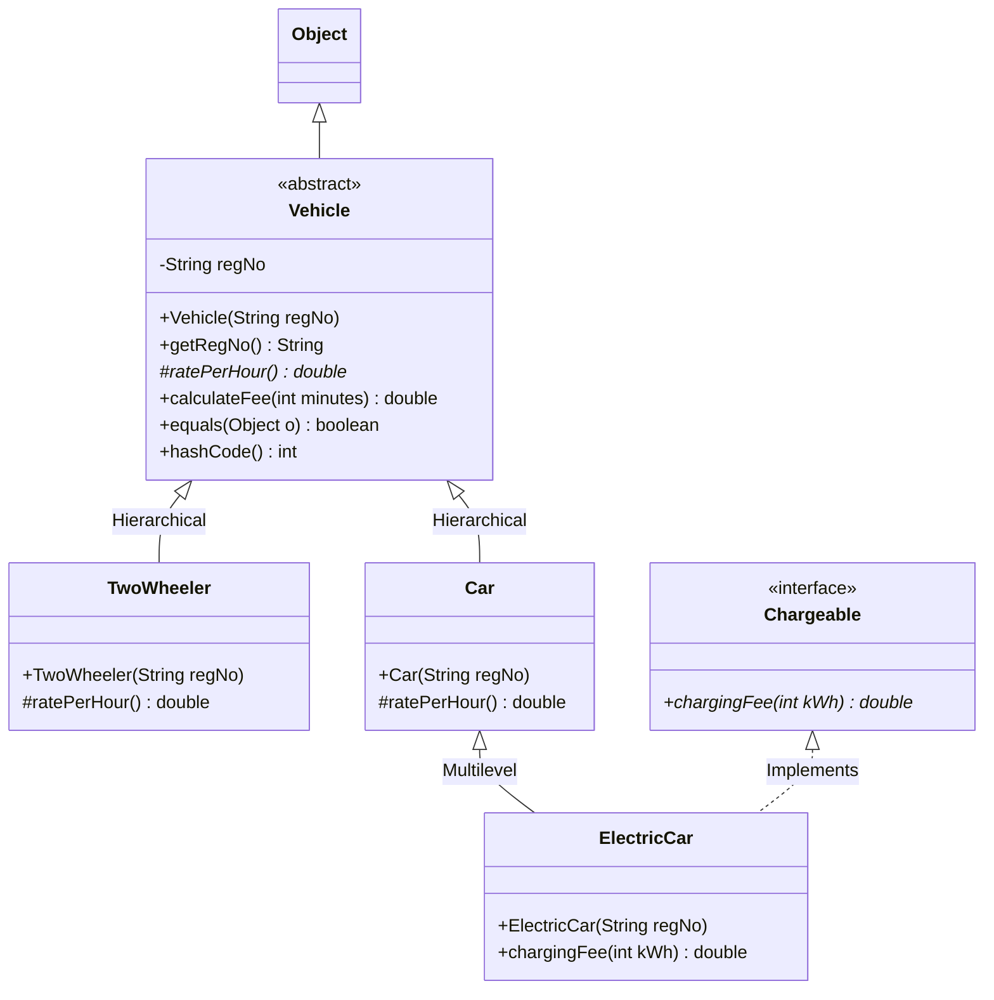

# Task 06 – Design the Inheritance Hierarchy

**Course Outcome:** CO1 – Java fundamentals and object-oriented programming  
**Bloom's Level:** K4 (Analyse)  
**Student Name:** Kattiripalli Dhanush  
**Register Number:** 192311094  

---

## 1. Inheritance Hierarchy Design

Inheritance enables code reusability and creates an "is-a" taxonomy. In our Campus Smart-Parking System, we employ both **Hierarchical Inheritance** and **Multilevel Inheritance**:



### Types of Inheritance Applied:
1. **Hierarchical Inheritance:** Multiple subclasses inherit from a single superclass.
   - `Vehicle` $\rightarrow$ `TwoWheeler`
   - `Vehicle` $\rightarrow$ `Car`
2. **Multilevel Inheritance:** A class inherits from a derived class forming an inheritance chain.
   - `Vehicle` $\rightarrow$ `Car` $\rightarrow$ `ElectricCar`
   - `ElectricCar` is-a `Car`, and `Car` is-a `Vehicle`.
3. **Multiple Interface Realization:**
   - Java does not permit multiple class inheritance (to avoid the Diamond Problem). However, `ElectricCar` extends `Car` and implements `Chargeable`, gaining both 4-wheeler behavioral inheritance and electrical charging capabilities.

---

## 2. Inherited vs Added Features in Subclasses

| Class | Superclass | Inherited Features | Added / Specialized Features |
| :--- | :--- | :--- | :--- |
| **`Vehicle`** | `java.lang.Object` | Basic object mechanics (`wait`, `notify`, default identity). | Abstract base; encapsulates `regNo`, `getRegNo()`, template `calculateFee(int minutes)`, `equals()`, and abstract `ratePerHour()`. |
| **`TwoWheeler`** | `Vehicle` | `regNo`, `getRegNo()`, `calculateFee()`. | Specializes `ratePerHour()` to return Rs 10.0/hr. |
| **`Car`** | `Vehicle` | `regNo`, `getRegNo()`, `calculateFee()`. | Specializes `ratePerHour()` to return Rs 30.0/hr. |
| **`ElectricCar`**| `Car` | Everything from `Car` and `Vehicle` (`ratePerHour() = 30.0`). | Implements `Chargeable`; adds `chargingFee(int kWh)` at Rs 12.0/kWh. |

---

## 3. Usage of the `super` Keyword

The `super` keyword in Java acts as a reference variable used to access immediate parent class members:
1. **`super(...)` in Constructors:**
   Subclass constructors do not inherit superclass constructors. They *must* call a parent constructor as their first statement.
   - `Car(String regNo) { super(regNo); }` delegates storage and validation of the registration number to `Vehicle`.
   - `ElectricCar(String regNo) { super(regNo); }` delegates to `Car(String regNo)`, which delegates to `Vehicle(String regNo)`.
2. **`super.method()`:**
   Invokes an overridden method in the superclass when a subclass wants to extend rather than completely replace behavior (e.g., `super.calculateFee(minutes)`).
3. **`super.field`:**
   Accesses a shadowed field in the superclass (avoided by keeping fields `private`).

---

## 4. Constructor Execution Order Trace (`ElectricCar`)

When the statement `Vehicle v = new ElectricCar("TN03C3");` executes, constructors execute in strict **top-down order (Superclass $\rightarrow$ Subclass)**:

```text
STEP 1: Memory allocated on heap for ElectricCar instance
STEP 2: ElectricCar("TN03C3") constructor invoked
         --> calls super("TN03C3") which is Car("TN03C3")
STEP 3: Car("TN03C3") constructor invoked
         --> calls super("TN03C3") which is Vehicle("TN03C3")
STEP 4: Vehicle("TN03C3") constructor invoked
         --> implicitly calls super() which is Object()
STEP 5: Object() constructor finishes
STEP 6: Vehicle field initialization: this.regNo = "TN03C3"; Vehicle constructor body completes
STEP 7: Car constructor body completes
STEP 8: ElectricCar constructor body completes
STEP 9: Reference to fully initialized object returned and stored in v
```

### Trace Table:
| Step | Active Constructor | Calling Mechanism | Action Performed |
| :---: | :--- | :--- | :--- |
| **1** | `java.lang.Object()` | Implicit `super()` | Initializes base JVM Object header. |
| **2** | `Vehicle(String regNo)` | Explicit `super(regNo)` | Sets `this.regNo = "TN03C3"`. |
| **3** | `Car(String regNo)` | Explicit `super(regNo)` | Instantiates 4-wheeler vehicle base. |
| **4** | `ElectricCar(String regNo)` | Invoked via `new` | Completes EV-specific initialization. |

---

## 5. Alternative Concept and Complexity Analysis

### Inheritance ("is-a") vs Composition ("has-a")

Instead of a class hierarchy (`Car is-a Vehicle`), an alternative design uses a single concrete `Vehicle` class that **has-a** `VehicleType` helper/record:
```java
public class VehicleType {
    private final String typeName;
    private final double hourlyRate;
    private final boolean isChargeable;
    // ...
}

public class Vehicle {
    private final String regNo;
    private final VehicleType type; // Composition
    public double calculateFee(int minutes) {
        return ((minutes + 59) / 60) * type.getHourlyRate();
    }
}
```

### Comparison Matrix

| Evaluation Criterion | Inheritance (`Car is-a Vehicle`) | Composition (`Vehicle has-a VehicleType`) |
| :--- | :--- | :--- |
| **Adding a New Vehicle Type** | Requires creating a new `.java` subclass file. Rigid compile-time hierarchy. | **Extremely dynamic.** A new type can be created at runtime simply by instantiating `new VehicleType("Truck", 50.0)`. |
| **Polymorphic Type Safety** | **High.** Compiler guarantees `Chargeable` can only be passed where expected. | Lower; requires querying boolean flags or enum properties. |
| **Time to Compute Fee** | $O(1)$ constant time via virtual method dispatch (`invokevirtual`). | $O(1)$ constant time via reference dereference (`type.getHourlyRate()`). Both sub-nanosecond. |
| **Memory / Space per Object** | **Low.** Single object header (16 bytes) + 1 reference field (`regNo` 8 bytes) = ~24 bytes. | **Higher.** Outer `Vehicle` object (24 bytes) + reference pointer (8 bytes) + inner `VehicleType` object (24 bytes) = ~56 bytes per instance. |

### Conclusion on Task 6
Inheritance is the standard, idiomatic OOP paradigm for fixed domain taxonomies where behavior fundamentally differs (e.g. `ElectricCar` implementing `Chargeable`). It guarantees compile-time type safety and aligns with academic object-oriented design principles.
