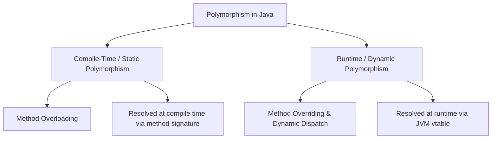

# Task 08 – Apply Polymorphism

**Course Outcome:** CO1 – Java fundamentals and object-oriented programming  
**Bloom's Level:** K4 (Analyse)  
**Student Name:** Kattiripalli Dhanush  
**Register Number:** 192311094  

---

## 1. Compile-Time vs Runtime Polymorphism

Polymorphism ("many forms") allows a single interface or reference type to represent different underlying forms:



---

## 2. Compile-Time Polymorphism (Method Overloading)

Method overloading occurs when multiple methods in the same class share the same name but have distinct parameter lists (different arity, different types, or different order).

### Example in Parking Fee Calculation:
```java
// Overloaded Method 1: Duration given as total elapsed minutes
public double calculateFee(int minutes) {
    int hours = (minutes + 59) / 60;
    return hours * ratePerHour();
}

// Overloaded Method 2: Duration calculated from entry and exit LocalTime instances
public double calculateFee(LocalTime entryTime, LocalTime exitTime) {
    long elapsedMinutes = java.time.Duration.between(entryTime, exitTime).toMinutes();
    return calculateFee((int) elapsedMinutes);
}
```

### How the Compiler Selects the Overload:
1. At compile time, the Java compiler inspects the arguments provided at the call site.
2. If the call passes an `int` (`v.calculateFee(130)`), the compiler binds the invocation to `calculateFee(int)`.
3. If the call passes two `LocalTime` arguments (`v.calculateFee(in, out)`), the compiler binds it to `calculateFee(LocalTime, LocalTime)`.
4. This static binding is recorded directly in the bytecode via `invokevirtual` with the exact parameter descriptor.

---

## 3. Runtime Polymorphism (Dynamic Method Dispatch & Upcasting)

Runtime polymorphism occurs when an overridden method is called through a superclass reference variable.

### Upcasting in an Heterogeneous Array:
```java
Vehicle[] parked = {
    new TwoWheeler("TN01A1"),   // Upcast TwoWheeler to Vehicle
    new Car("TN02B2"),          // Upcast Car to Vehicle
    new ElectricCar("TN03C3")   // Upcast ElectricCar to Vehicle
};
```
Each element in the array is of declared type `Vehicle`, but points to a concrete subclass object on the heap.

### Dynamic Method Dispatch in Action:
When the loop executes:
```java
for (Vehicle v : parked) {
    double fee = v.calculateFee(130);
    // ...
}
```
The method `v.calculateFee(130)` executes the template method in `Vehicle`, which internally calls `ratePerHour()`. At runtime, the JVM looks at the **actual object on the heap** pointed to by `v` and dynamically dispatches `ratePerHour()` to that subclass's implementation using its virtual method table (`vtable`).

---

## 4. Trace of Dynamic Method Dispatch

Let us trace the invocation for the third element in the array:
```java
Vehicle v = parked[2]; // Points to ElectricCar("TN03C3")
double fee = v.calculateFee(130);
```

| Dimension | Value / Action |
| :--- | :--- |
| **Declared (Static) Type** | `Vehicle` |
| **Actual Runtime Object Type** | `ElectricCar` |
| **Method Invoked at Call Site** | `Vehicle.calculateFee(int minutes)` |
| **Internal Virtual Call** | `this.ratePerHour()` |
| **vtable Resolution** | JVM inspects the object header of `ElectricCar` $\rightarrow$ finds `Car.ratePerHour()` in the vtable $\rightarrow$ executes and returns `30.0`. |
| **Billable Hours Calculation** | $(130 + 59) / 60 = 189 / 60 = 3\text{ hours}$. |
| **Base Fee Returned** | $3 \times 30.0 = \text{Rs } 90.0$. |
| **Downcast / Pattern Match** | `if (v instanceof Chargeable c)` evaluates to `true` (since `ElectricCar` implements `Chargeable`). |
| **Charging Fee Added** | `c.chargingFee(10)` $\rightarrow 10 \times 12.0 = \text{Rs } 120.0$. |
| **Final Computed Fee** | $90.0 + 120.0 = \mathbf{Rs\ 210.0}$. |

---

## 5. Why Polymorphism Avoids Brittle `if-else` Chains

Without polymorphism, calculating fees requires inspecting vehicle types using fragile condition chains:
```java
// ANTI-PATTERN: Brittle if-else chain
for (Vehicle v : parked) {
    double fee = 0;
    if (v instanceof TwoWheeler) {
        fee = ((TwoWheeler) v).calculateFee(130);
    } else if (v instanceof ElectricCar) {
        fee = ((ElectricCar) v).calculateFee(130) + ((ElectricCar) v).chargingFee(10);
    } else if (v instanceof Car) {
        fee = ((Car) v).calculateFee(130);
    }
}
```
### Problems with `if-else` Chains:
1. **Order Sensitivity:** In the code above, `if (v instanceof Car)` placed before `if (v instanceof ElectricCar)` would intercept electric cars, wrongly preventing EV charging calculations because `ElectricCar` is an instance of `Car`!
2. **Violation of Open-Closed Principle (OCP):** Adding any new vehicle type requires modifying every single `if-else` cascade in the codebase.
3. **With Polymorphism:** The caller simply writes `v.calculateFee(minutes)`. The JVM handles type-specific execution automatically and safely.

---

## 6. Analysis of `equals()` Output: Why `Car("TN02B2").equals(ElectricCar("TN02B2"))` Prints `true`

In `FeeDemo`, the last line executes:
```java
System.out.println(new Car("TN02B2").equals(new ElectricCar("TN02B2")));
```
This prints **`true`**.

### Detailed Technical Explanation:
The `equals` method in `Vehicle` is defined as:
```java
@Override
public boolean equals(Object o) {
    return o instanceof Vehicle && regNo.equals(((Vehicle) o).regNo);
}
```
1. `new Car("TN02B2")` invokes `equals(Object o)` passing `new ElectricCar("TN02B2")`.
2. The condition `o instanceof Vehicle` evaluates to `true` because `ElectricCar` is a subclass of `Car`, which is a subclass of `Vehicle`.
3. The registration numbers of both objects are `"TN02B2"`, so `regNo.equals(...)` evaluates to `true`.
4. Therefore, the method returns `true`.

### Is this the correct behaviour for our system?
**YES, it is completely correct for a campus smart-parking domain:**
- In traffic law and parking administration, a vehicle's **business identity** is uniquely and globally defined by its official registration number (license plate).
- A license plate `"TN02B2"` represents a single physical automobile. Two physical vehicles cannot legally hold the identical license plate at the same time.
- If a security camera, RFID sensor, or attendant registers `"TN02B2"` as an entering vehicle, the system must recognize it as the same vehicle identity, preventing fraudulent double-entry into the facility.
- By adhering to the `regNo` equality contract, the system correctly preserves symmetry (`car.equals(ev) == ev.equals(car)`), transitivity, and consistency across collections like `HashSet<Vehicle>` and `HashMap<Vehicle, ParkingTicket>`.

---

## 7. Alternative Concept and Complexity Analysis

### Dynamic Method Dispatch vs `instanceof` Cascades

| Metric | Dynamic Method Dispatch (OOP) | `instanceof` Checks & Explicit Downcasting |
| :--- | :--- | :--- |
| **Time Complexity per Call** | **$O(1)$ constant time.** The JVM resolves method address through a single indexed offset in the class's `vtable`. | **$O(k)$ linear time worst case.** Evaluates up to $k$ sequential condition checks, testing subtype compatibility one by one. |
| **Code Size & Maintenance** | **Compact & Scalable.** New vehicle types do not change the caller code. Zero modifications to existing classes. | **Bloated & Fragile.** Adding a $(k+1)$-th type requires adding new `else if` branches to every method operating on vehicles. |
| **Subtype Bug Vulnerability** | **None.** The JVM always dispatches to the most derived overridden method. | **High.** If a superclass check (`instanceof Car`) appears before a subclass check (`instanceof ElectricCar`), the subclass block is never reached! |
