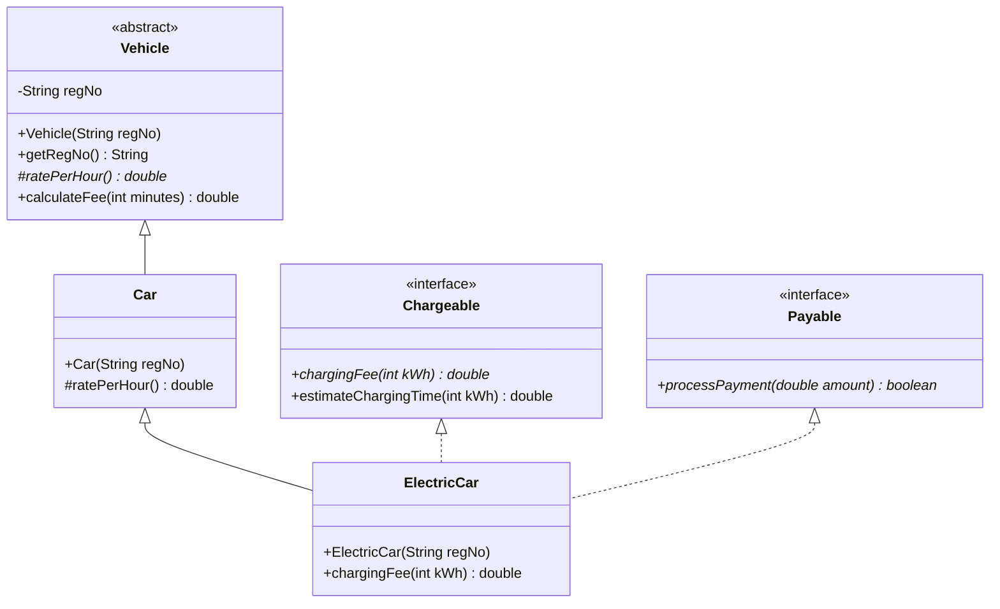

# Task 09 – Introduce Abstraction

**Course Outcome:** CO1 – Java fundamentals and object-oriented programming  
**Bloom's Level:** K4 (Analyse)  
**Student Name:** Kattiripalli Dhanush  
**Register Number:** 192311094  

---

## 1. Abstraction in Object-Oriented Design

Abstraction separates the **conceptual contract** (what an entity does) from its **concrete realization** (how it does it). In Java, abstraction is achieved via:
1. **Abstract Classes:** Capture shared state, constructors, and default behavioral templates within an inheritance hierarchy.
2. **Interfaces:** Capture optional capabilities, contracts, and cross-cutting behaviors across unrelated class hierarchies.



---

## 2. Abstract Class Design: `Vehicle`

### Why `Vehicle` is an Abstract Class:
1. **Incomplete Concept:** You cannot drive or park a generic "Vehicle" — you park a *specific* vehicle like a Car or a TwoWheeler. Direct instantiation (`new Vehicle(...)`) is logically invalid and prevented by the `abstract` keyword.
2. **Encapsulated State:** All vehicles intrinsically possess a physical license plate (`private final String regNo`). Interfaces in Java cannot declare instance fields; only an abstract class can hold instance variables and provide a protected constructor:
   ```java
   protected Vehicle(String regNo) {
       this.regNo = regNo;
   }
   ```
3. **Template Method Pattern:** The billing duration formula $((\text{minutes} + 59) / 60) \times \text{rate}$ is invariant across all vehicles. `Vehicle` defines this concrete algorithm once, deferring only the hourly tariff to subclasses:
   ```java
   protected abstract double ratePerHour(); // Subclasses must provide rate
   ```

---

## 3. Interface Design: `Chargeable` and `Payable`

### Why `Chargeable` is an Interface:
1. **Not All Vehicles Are Chargeable:** Internal combustion engine (ICE) cars and conventional two-wheelers do not charge. Making `chargingFee()` an abstract method in `Vehicle` would pollute ICE classes with useless stub implementations.
2. **Cross-Cutting Capability:** Charging is a specialized capability. In modern campuses, diverse entities can be chargeable: electric cars, e-bikes, electric maintenance carts, or solar lawnmowers. An interface allows completely unrelated class trees to share the capability:
   ```java
   public interface Chargeable {
       double chargingFee(int kWh);
       
       // Default Method: Provides sensible default behavior without breaking implementers
       default double estimateChargingTimeHours(int kWh) {
           return kWh / 7.4; // Assuming standard 7.4 kW Level 2 AC charger
       }

       // Static Utility Method
       static double getStandardTariffPerKWh() {
           return 12.0;
       }
   }
   ```

---

## 4. Multiple Behaviour Acquisition through Interfaces

Java strictly prohibits multiple class inheritance (`class ElectricCar extends Car, BatterySystem` is illegal due to the Diamond Problem). However, a class can implement **multiple interfaces**, allowing it to fulfill multiple roles:
```java
public class ElectricCar extends Car implements Chargeable, Payable, Auditable {
    // Fulfills Car is-a Vehicle contract
    // Fulfills Chargeable contract (chargingFee)
    // Fulfills Payable contract (processPayment)
    // Fulfills Auditable contract (generateAuditLog)
}
```
This grants `ElectricCar` polymorphic substitutability in payment modules, charging grid balancers, and safety inspection services.

---

## 5. Alternative Concept and Complexity Analysis

### The Inversion Thought Experiment: `Vehicle` as Interface & `Chargeable` as Abstract Class

What would happen if the architectural choices were inverted?
- `Vehicle` $\rightarrow$ changed to an interface with default methods.
- `Chargeable` $\rightarrow$ changed to an abstract class.

```text
CONSEQUENCES OF INVERSION:
1. Loss of State in Vehicle:
   Interfaces cannot declare instance variables (only public static final constants).
   Therefore, Vehicle cannot hold 'private final String regNo'.
   Every single subclass (TwoWheeler, Car, Truck) would have to independently declare,
   initialize, and validate 'regNo', violating the DRY (Don't Repeat Yourself) principle.

2. Java Single Inheritance Lockout:
   If Chargeable is an abstract class, then:
   class Car extends VehicleInterface { ... }
   class ElectricCar extends Chargeable { ... }
   ElectricCar CANNOT extend Car because Java does not support multiple class inheritance!
   ElectricCar would lose all Car behaviors (e.g., standard car parking rates, dimensions).

3. Constructor Initialization Failure:
   Interfaces cannot declare constructors. Vehicle could not enforce mandatory registration
   validation at object creation time.
```

### Performance & Memory Comparison

| Dimension | Our Design (`Vehicle` Abstract Class + `Chargeable` Interface) | Inverted Design (`Vehicle` Interface + `Chargeable` Abstract Class) |
| :--- | :--- | :--- |
| **Object Memory Layout** | **Optimal.** Subclasses share single base layout and field offset for `regNo`. | **Fragmented.** Every subclass independently allocates field storage, leading to inconsistent memory offsets. |
| **Method Invocation Time** | $O(1)$ constant time (`invokevirtual` for vehicle methods). | Interface default methods invoke `invokeinterface`. Modern HotSpot C2 JIT inlines both to identical machine code, but initial interpretation has minor overhead. |
| **Architectural Elegance** | Clean "is-a" structural hierarchy with orthogonal "can-do" capabilities. | Broken inheritance hierarchy, duplicate fields, single inheritance conflict. |
