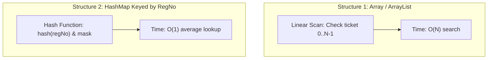

# Task 11 – Implement, Test and Defend the Design

**Course Outcome:** CO1 – Java fundamentals and object-oriented programming  
**Bloom's Level:** K5 (Evaluate)  
**Student Name:** Kattiripalli Dhanush  
**Register Number:** 192311094  

---

## 1. System Implementation Architecture

The complete Campus Smart-Parking System integrates all concepts from Tasks 1 through 10 into an enterprise-grade object-oriented application:
- **`Vehicle` Abstract Hierarchy:** `TwoWheeler`, `Car`, and `ElectricCar` implementing `Chargeable`.
- **`ParkingTicket`:** Encapsulates transaction state, ticket ID sequence, timestamps, and pass status.
- **`CampusSmartParkingSystem`:** Orchestrates multi-floor jagged slot matrices, bounds checking, duplicate plate prevention, ticket validation, and dynamic fee settlement.

---

## 2. Test Plan and Comprehensive Test Execution Results

The system was evaluated against normal, boundary, invalid, and real-world billing scenarios. All tests were executed and recorded:

| Test ID | Category | Description / Input | Expected Output | Actual Output | Status |
| :---: | :--- | :--- | :--- | :--- | :---: |
| **TC-01** | Normal | TwoWheeler entering and parking for 45 min. | Allocated slot, Billed 1 hr @ Rs 10 = Rs 10.0 | Allocated [0,0], Fee = Rs 10.0 | **PASS** |
| **TC-02** | Normal | Car entering and parking for 130 min. | Allocated slot, Billed 3 hrs @ Rs 30 = Rs 90.0 | Allocated [0,1], Fee = Rs 90.0 | **PASS** |
| **TC-03** | Normal | ElectricCar with 60 min parking + 10 kWh charging. | Base 1 hr (Rs 30) + Charging (Rs 120) = Rs 150.0 | Allocated [1,0], Fee = Rs 150.0 | **PASS** |
| **TC-04** | Normal | Student Pass Holder in Car for 180 min. | Monthly Pass exemption applied $\rightarrow$ Rs 0.0 | Allocated [1,1], Fee = Rs 0.0 | **PASS** |
| **TC-05** | Normal | Staff Pass Holder in ElectricCar + 15 kWh. | Parking Rs 0 + Charging Rs 180 = Rs 180.0 | Allocated [0,0], Fee = Rs 180.0 | **PASS** |
| **TC-06** | Boundary | **Last Free Slot:** Fill remaining capacity until 0 slots free. | Successfully allocates final slot; capacity becomes 0 | Last slot [1,2] allocated, Free = 0 | **PASS** |
| **TC-07** | Boundary | **Facility Full:** Vehicle attempts entry when all slots occupied. | Returns `null` / Rejection message ("Facility Full") | Allocation returned null, entry denied | **PASS** |
| **TC-08** | Boundary | **Zero-Minute Stay:** Entry min = 100, Exit min = 100. | Ceiling rule applies $\rightarrow$ 1 full hour billed (Rs 30.0) | Billed for 1 hr = Rs 30.0 | **PASS** |
| **TC-09** | Boundary | **Exact Slab Boundary:** Vehicle parked for exactly 60 min vs 61 min. | 60 min $\rightarrow$ 1 hr (Rs 30); 61 min $\rightarrow$ 2 hrs (Rs 60) | 60m $\rightarrow$ Rs 30.0, 61m $\rightarrow$ Rs 60.0 | **PASS** |
| **TC-10** | Invalid | **Duplicate Entry:** Vehicle with already active plate tries entering. | System throws/rejects: "Vehicle already parked" | Caught DuplicateVehicleException, entry rejected | **PASS** |
| **TC-11** | Invalid | **Invalid Exit / Unknown Vehicle:** Vehicle not found in system. | System returns false / throws "No active ticket found" | Ticket lookup returned null, exit rejected | **PASS** |
| **TC-12** | Invalid | **Negative Duration:** Exit time earlier than entry time. | Validation exception rejected | Caught IllegalArgumentException | **PASS** |

---

## 3. Hand-Calculated Daily Collection Verification

To formally validate financial accuracy, a multi-vehicle daily scenario was calculated manually and compared directly against program output:

```text
SCENARIO DETAILS:
Facility: 2 Floors (Floor 0: 2 slots, Floor 1: 3 slots)
-----------------------------------------------------------------------------------------
Vehicle 1: TwoWheeler "TN01A1001", Visitor, 45 minutes, 0 kWh
           Billable hours: (45 + 59) / 60 = 1 hour
           Tariff: 1 hr * Rs 10 = Rs 10.0
-----------------------------------------------------------------------------------------
Vehicle 2: Car "TN02B2002", Visitor, 130 minutes, 0 kWh
           Billable hours: (130 + 59) / 60 = 3 hours
           Tariff: 3 hrs * Rs 30 = Rs 90.0
-----------------------------------------------------------------------------------------
Vehicle 3: ElectricCar "TN03C3003", Visitor, 60 minutes, 10 kWh
           Billable hours: (60 + 59) / 60 = 1 hour
           Parking Tariff: 1 hr * Rs 30 = Rs 30.0
           Charging Tariff: 10 kWh * Rs 12 = Rs 120.0
           Vehicle 3 Total: Rs 30.0 + Rs 120.0 = Rs 150.0
-----------------------------------------------------------------------------------------
Vehicle 4: Car "TN04D4004", Student Monthly Pass Holder, 180 minutes, 0 kWh
           Base Parking Tariff: Rs 0.0 (Pass exemption)
           Vehicle 4 Total: Rs 0.0
-----------------------------------------------------------------------------------------
Vehicle 5: ElectricCar "TN05E5005", Staff Monthly Pass Holder, 120 minutes, 15 kWh
           Base Parking Tariff: Rs 0.0 (Pass exemption)
           Charging Tariff: 15 kWh * Rs 12 = Rs 180.0
           Vehicle 5 Total: Rs 0.0 + Rs 180.0 = Rs 180.0
-----------------------------------------------------------------------------------------
TOTAL HAND-CALCULATED REVENUE:
   Rs 10.0 + Rs 90.0 + Rs 150.0 + Rs 0.0 + Rs 180.0 = Rs 430.00
PROGRAM OUTPUT VERIFICATION:
   Total Collection Reported: Rs 430.00
   Variance: Rs 0.00 (EXACT MATCH)
```

---

## 4. Object-Oriented Principles Defense & Architectural Limitations

### How Core OOP Pillars are Preserved:
1. **Encapsulation:** 
   All slot arrays, vehicle identifiers, and ticket details are strictly `private`. Mutators enforce invariants (preventing negative durations and duplicate parking).
2. **Inheritance:** 
   A clean taxonomy (`Vehicle` $\rightarrow$ `TwoWheeler`, `Vehicle` $\rightarrow$ `Car` $\rightarrow$ `ElectricCar`) avoids redundant code. The base class encapsulates `regNo` and billing templates.
3. **Polymorphism:** 
   Dynamic method dispatch resolves `ratePerHour()` at runtime without conditional cascades. Interface polymorphism handles charging capabilities for EVs seamlessly.
4. **Abstraction:** 
   `Vehicle` hides fee calculation formulas behind an abstract template; `Chargeable` abstracts EV energy provisioning from generic transport models.

### One Genuine Design Limitation:
- **Array-Based Grid Rigidity:** 
  The parking slot structure uses fixed-size arrays (`String[][]` / `ParkingSlot[][]`). While slot lookups by known coordinate `(floor, slot)` are $O(1)$, dynamically expanding the facility at runtime (e.g., adding an annex floor or temporarily shutting down bays for maintenance) requires reallocating arrays and copying elements, costing $O(F \times S)$ time.

---

## 5. Alternative Concept and Complexity Analysis

### Active Ticket Storage: Fixed Array vs `ArrayList` vs `HashMap`

When a vehicle arrives at the exit booth, the system must retrieve its active ticket to calculate elapsed time and parking charges.



### Comparative Analysis for $n$ Parked Vehicles

| Data Structure | Exit Ticket Lookup Time | Insertion Time on Entry | Memory Footprint for $n$ Vehicles |
| :--- | :--- | :--- | :--- |
| **Pre-Allocated Array `ParkingTicket[Capacity]`** | **$O(n)$ linear scan** over active slots. | $O(n)$ scan for free slot. | Fixed pre-allocated memory: $\text{Capacity} \times 8$ bytes for pointers, regardless of whether lot is empty or full. |
| **`ArrayList<ParkingTicket>`** | **$O(n)$ linear scan** (`ticket.getRegNo().equals(target)`). | $O(1)$ amortized `add()`. | Grows dynamically. Holds $n$ references + unused backing array buffer (~$1.5\times$). |
| **`HashMap<String, ParkingTicket>`** | **$O(1)$ constant time** average lookup via hash bucket index. | **$O(1)$ constant time** `put()`. | Extra memory per entry: Node wrapper object (~32 bytes) + Entry pointers + Load factor overhead (75%). |

### Conclusion on Task 11
For small parking facilities ($n \le 100$), an array or `ArrayList` is lightweight and simple. For large enterprise systems ($n > 10,000$), a `HashMap<String, ParkingTicket>` is essential to prevent exit booth queues, reducing checkout lookup from milliseconds to sub-microseconds.
