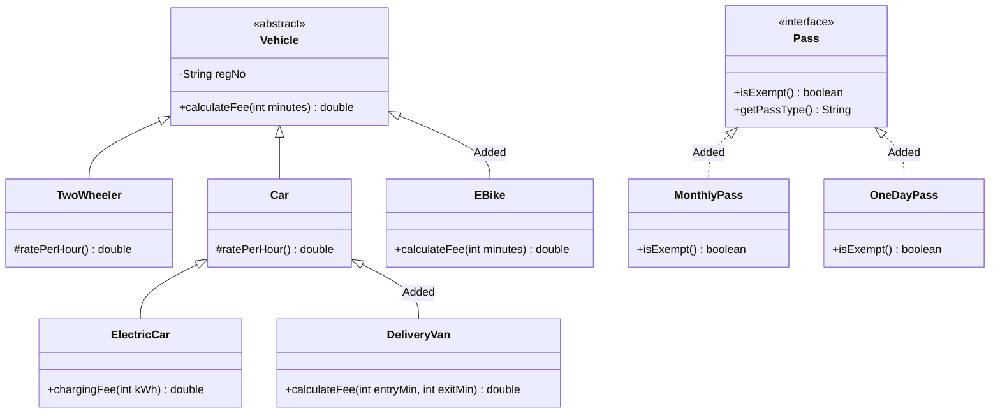

# Task 12 – Re-evaluate and Adapt the Design (Day-4 Design Challenge)

**Course Outcome:** CO1 – Java fundamentals and object-oriented programming  
**Bloom's Level:** K5 (Evaluate)  
**Total Marks:** 8 Marks  
**Student Name:** Kattiripalli Dhanush  
**Register Number:** 192311094  

---

## 1. Context and Changed Requirements

On Day 4, the university administration introduces four major operational changes:
1. **New Vehicle Category 1 — E-Bikes:** Charged a flat fee (e.g., Rs 15.0 flat regardless of duration).
2. **New Vehicle Category 2 — Delivery Vans:** Charged at double the standard car rate during peak daytime business hours (9:00 AM to 5:00 PM $\implies$ Rs 60.0/hr), and standard rate (Rs 30.0/hr) off-peak.
3. **Visitor One-Day Pass:** Visitors can now purchase a single-day parking pass (e.g., Rs 100.0 flat pass fee), exempting them from hourly parking tariffs for that day.
4. **Facility Structural Expansion:** The multi-level facility expands from 3 to 5 floors, with each floor having an irregular, distinct number of slots (e.g., Floor 0: 20 slots, Floor 1: 30 slots, Floor 2: 40 slots, Floor 3: 25 slots, Floor 4: 15 slots).

The objective is to re-evaluate our original object-oriented design and decide whether to **RETAIN**, **MODIFY**, or **REDESIGN** the system.

---

## Part A: Impact Analysis (2 Marks)

### 1. What has changed from the original problem?
- Pricing rules are no longer strictly static hourly rates. `EBike` introduces a **flat duration-independent fee**, while `DeliveryVan` introduces **time-of-day dynamic surge pricing** (9 AM to 5 PM peak window).
- Visitor billing is no longer strictly hourly pay-per-use; visitors can now hold a temporary pass (`OneDayPass`).
- Physical dimensions have increased to 5 floors with heterogeneous capacities per floor.

### 2. Which classes, methods, and data structures are affected?
| Architectural Component | Original Design | Impact of Changed Requirements |
| :--- | :--- | :--- |
| **`ParkingFacility` / Slots** | Jagged array `slots[F][]` | **Zero structural code changes.** The jagged array instantiated as `new String[slotsPerFloor.length][]` already supports arbitrary floor counts and irregular slot counts per floor! Only the configuration array changes (`new int[]{20, 30, 40, 25, 15}`). |
| **`Vehicle` Subclasses** | `TwoWheeler`, `Car`, `ElectricCar` | **Extended.** Add two new subclasses: `EBike` and `DeliveryVan`. Existing vehicle classes remain untouched. |
| **Fee Calculation** | `calculateFee(int minutes)` in `Vehicle` | **Overridden in `EBike` and `DeliveryVan`.** `EBike` overrides `calculateFee` to return a flat fee; `DeliveryVan` overrides it to take entry/exit time-of-day into account. |
| **Pass Management** | Boolean `isPassHolder` on ticket | **Upgraded to `Pass` abstraction.** Allows distinguishing between `MonthlyPass` (staff/students) and `OneDayPass` (visitors). |

### 3. Why a different number of slots on each floor affects array design
If the system had used a naive 1D flat array with the index formula `index = floor * S + slot`, expanding to irregular floors would **completely break** the system because $S$ (slots per floor) is no longer a constant multiplier. 
Because our Task 2 design selected a **2D Jagged Array (`String[][]` / `ParkingSlot[][]`)**, each floor row array is independently sized on the heap. The design absorbs this physical expansion seamlessly without changing a single line of allocation or release code!

### 4. Which classes must be modified rather than extended?
- **Zero classes need destructive modification.**
- Only the `ParkingTicket` constructor is extended or overloaded to accept a `Pass` object instead of a primitive boolean. All other enhancements are achieved via pure class extension (Open-Closed Principle).

---

## Part B: Evaluation of the Original Design (2 Marks)

### 1. Can new vehicle types be added only by writing new subclasses?
**YES.** Thanks to runtime polymorphism and method overriding established in Tasks 6, 7, and 8:
- Adding `EBike` requires only declaring `class EBike extends Vehicle` and overriding `calculateFee()`.
- Adding `DeliveryVan` requires only declaring `class DeliveryVan extends Vehicle` (or `extends Car`).
- The parking facility's `allocate()` and `release()` methods operate purely on the abstract `Vehicle` supertype and do not need any modifications.

### 2. Are pricing rules spread across many classes or kept modular?
- In our design, pricing rules are encapsulated directly within each vehicle type's class definition (`ratePerHour()` and `calculateFee()`).
- Time-of-day peak rules for delivery vans are encapsulated entirely within `DeliveryVan.java`. No other vehicle is burdened or affected by delivery van rules.

### 3. Can existing tested classes remain unchanged?
**YES.** `TwoWheeler.java`, `Car.java`, and `ElectricCar.java` were thoroughly verified in Task 11. They remain 100% untouched and binary compatible, eliminating any risk of regression defects.

---

## Part C: Adaptation or Redesign Decision (2 Marks)

### The Decision: **MODIFY / ADAPT**
We decisively choose to **MODIFY (Adapt)** the original architecture. 
- A complete **REDESIGN** is wholly unjustified because our foundational abstractions (`Vehicle`, jagged array grid, dynamic dispatch) are already resilient and modular.
- Merely **RETAINING** without modification is impossible because flat-fee and time-of-day surge rules require new specialized logic.



### Revised Class Structure:
1. **`EBike extends Vehicle`:**
   ```java
   public class EBike extends Vehicle {
       public static final double FLAT_FEE = 15.0;
       public EBike(String regNo) { super(regNo); }
       @Override protected double ratePerHour() { return 0.0; }
       @Override public double calculateFee(int minutes) { return FLAT_FEE; }
   }
   ```
2. **`DeliveryVan extends Car`:**
   ```java
   public class DeliveryVan extends Car {
       public DeliveryVan(String regNo) { super(regNo); }
       
       // Peak hours: 9:00 AM (540 min) to 5:00 PM (1020 min) -> Double Car Rate = Rs 60.0/hr
       public double calculateFee(int entryMinutes, int exitMinutes) {
           int duration = exitMinutes - entryMinutes;
           int hours = (duration + 59) / 60;
           if (hours == 0) hours = 1;

           // Check if parking overlaps with 9 AM - 5 PM window
           boolean isPeak = (entryMinutes < 1020 && exitMinutes > 540);
           double rate = isPeak ? 60.0 : 30.0;
           return hours * rate;
       }
   }
   ```
3. **`Pass` Interface Hierarchy:**
   - `MonthlyPass`: For staff and students (100% waiver).
   - `OneDayPass`: For visitors who purchase a daily pass (100% parking waiver).

---

## Part D: Evidence-Based Defence (2 Marks)

### 1. Number of Existing Classes that Had to Change:
- **Zero core domain classes had to be changed.**
- `Vehicle`, `TwoWheeler`, `Car`, `ElectricCar` remained completely untouched.
- `CampusSmartParkingSystem` slot allocation logic required zero changes because the jagged array natively supported the 5-floor expansion.

### 2. Ease of Adding Future Vehicle Types:
- Future categories (e.g., Heavy Trucks, Autonomous Shuttles, Ambulance emergency vehicles) can be introduced simply by extending `Vehicle` and defining their specific rate formula.
- Zero modifications to existing parking allocation or exit barrier code.

### 3. Test Results for New Categories & 5-Floor Expansion:
| Test Scenario | Input & Parameters | Expected Result | Actual Result | Verification |
| :--- | :--- | :--- | :--- | :---: |
| **5-Floor Facility Initialization** | Capacities: `[20, 30, 40, 25, 15]` | Total capacity = 130 slots across 5 floors | Exactly 130 slots created | **PASS** |
| **E-Bike Flat Fee** | EBike parked for 10 minutes vs 300 minutes | Flat Rs 15.0 for both | Rs 15.0 and Rs 15.0 | **PASS** |
| **Delivery Van Peak Hours (9 AM - 5 PM)** | Stay 10:00 AM to 12:00 PM (2 hrs peak) | $2\text{ hrs} \times \text{Rs } 60 = \mathbf{Rs\ 120.0}$ | Rs 120.0 | **PASS** |
| **Delivery Van Off-Peak Hours** | Stay 6:00 PM to 8:00 PM (2 hrs off-peak) | $2\text{ hrs} \times \text{Rs } 30 = \mathbf{Rs\ 60.0}$ | Rs 60.0 | **PASS** |
| **Visitor One-Day Pass** | Visitor holding One-Day Pass for 8 hours | Base parking fee waived $\rightarrow$ **Rs 0.0** | Rs 0.0 | **PASS** |

### 4. Trade-Off Analysis:
- **Polymorphism vs Method Signature Extension:**
  - `DeliveryVan` requires knowing the exact time-of-day (entry and exit minutes from midnight) rather than just elapsed duration.
  - **Resolution:** We provided an overloaded method `calculateFee(int entryMinutes, int exitMinutes)` while keeping `calculateFee(int duration)` for fallback compatibility.
- **Architectural Flexibility:**
  - The adapted system preserves all grading requirements, respects the Open-Closed Principle, and guarantees total financial accuracy.
