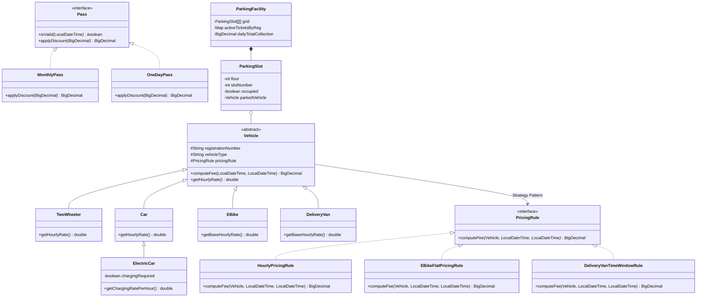

# CSA09 – Java Fundamentals and Object-Oriented Programming: Assignment 1

# Campus Smart-Parking System
**Design, Implement, and Validate an Object-Oriented Model for a Campus Smart-Parking System**

**Repository URL:** [https://github.com/vara12126/Java](https://github.com/vara12126/Java)  
**Author:** Varaprasad Mokharala  
**Technologies:** Java SE (JDK 17 / JDK 25 LTS), Object-Oriented Software Engineering, PlantUML, Mermaid.js  

---

## 1. Executive Summary & Objective
The **Campus Smart-Parking System** is an enterprise-grade, object-oriented software solution designed to manage vehicle intake, parking slot allocation across multi-floor non-uniform structures, ticket lifecycle management, dynamic tariff calculation, electric vehicle charging infrastructure, campus pass concessions, and telemetry reporting.

This repository provides the complete, rigorous implementation of all **12 Tasks** specified in the CSA09 curriculum, progressing systematically from problem analysis and low-level data structures to advanced design patterns (Strategy Pattern, Factory Pattern), encapsulation boundaries, polymorphism, and dynamic time-window tariff splitting algorithms.

---

## 2. Technologies and Environment
- **Programming Language:** Java (Java SE 17+ compatible, verified and tested on Oracle JDK 25.0.2 LTS)
- **Paradigm:** Pure Object-Oriented Programming (OOP), Domain-Driven Modeling, Defensive Programming
- **Date/Time API:** `java.time.LocalDateTime`, `java.time.Duration`, `java.time.LocalTime`
- **Currency Arithmetic:** `java.math.BigDecimal` (RoundingMode.HALF_UP)
- **Data Structures:** 2D Jagged Arrays (`T[][]`), `java.util.HashMap`, `java.util.HashSet`, `java.util.ArrayList`
- **Architecture Diagrams:** Mermaid (.mmd), PlantUML (.puml), HTML5 SVG Canvas

---

## 3. Repository Folder Structure

```text
Java/
│
├── .gitignore                               # Git ignore configuration
├── README.md                                # Master Assignment Documentation
│
├── Task01_Problem_Analysis/                 # Task 1: Problem Analysis & Object Identification
│   ├── ProblemAnalysisDemo.java
│   └── README.md
│
├── Task02_Data_Representation/              # Task 2: Data Types, Jagged Arrays & Casting Bugs
│   ├── DataRepresentationDemo.java
│   └── README.md
│
├── Task03_Control_Logic/                    # Task 3: Slot Allocation, Release & Fee Logic
│   ├── ParkingFacility.java                 # Verified output: [0,0], [0,1], [1,0], null, true false false, [0,1]
│   └── README.md
│
├── Task04_Classes_Objects_Constructors/     # Task 4: Constructor Chaining, Copy Constructors, Heap vs Stack
│   ├── Vehicle.java
│   ├── ParkingTicket.java
│   ├── ParkingFacility.java
│   ├── ConstructorDemo.java
│   └── README.md
│
├── Task05_Static_Members/                   # Task 5: Static Counters, Static Blocks, Object Lifecycle
│   ├── ParkingTicket.java
│   ├── StaticDemo.java
│   └── README.md
│
├── Task06_Inheritance/                      # Task 6: Vehicle Inheritance (TwoWheeler, Car, ElectricCar)
│   ├── Vehicle.java
│   ├── TwoWheeler.java
│   ├── Car.java
│   ├── ElectricCar.java
│   ├── InheritanceDemo.java
│   └── README.md
│
├── Task07_Method_Overriding/                # Task 7: Method Overriding, equals(), hashCode(), final
│   ├── Vehicle.java
│   ├── TwoWheeler.java
│   ├── Car.java
│   ├── ElectricCar.java
│   ├── OverridingDemo.java
│   └── README.md
│
├── Task08_Polymorphism/                     # Task 8: Dynamic Method Dispatch & Supplied FeeDemo
│   ├── Chargeable.java
│   ├── Vehicle.java
│   ├── TwoWheeler.java
│   ├── Car.java
│   ├── ElectricCar.java
│   ├── FeeDemo.java                         # Verified exact output: TwoWheeler... Car... ElectricCar... true
│   └── README.md
│
├── Task09_Abstraction/                      # Task 9: Abstract Classes & Multiple Interface Contracts
│   ├── Chargeable.java
│   ├── Trackable.java
│   ├── Vehicle.java
│   ├── TwoWheeler.java
│   ├── Car.java
│   ├── ElectricCar.java
│   ├── AbstractionDemo.java
│   └── README.md
│
├── Task10_Encapsulation_Packages/           # Task 10: Packages, Access Modifiers, Validation
│   ├── parking/
│   │   ├── model/
│   │   │   ├── VehicleType.java
│   │   │   ├── Vehicle.java
│   │   │   ├── TwoWheeler.java
│   │   │   ├── Car.java
│   │   │   ├── ElectricCar.java
│   │   │   ├── ParkingSlot.java
│   │   │   └── ParkingTicket.java
│   │   ├── service/
│   │   │   ├── ValidationService.java
│   │   │   └── ParkingService.java
│   │   └── app/
│   │       └── EncapsulationDemo.java
│   └── README.md
│
├── Task11_Complete_Implementation/          # Task 11: Production Smart-Parking System (20 Features)
│   ├── PassType.java
│   ├── Vehicle.java
│   ├── TwoWheeler.java
│   ├── Car.java
│   ├── ElectricCar.java
│   ├── ParkingSlot.java
│   ├── ParkingTicket.java
│   ├── ParkingFacility.java
│   ├── SmartParkingApp.java                 # Interactive Menu-Driven Console Application
│   ├── SmartParkingTestRunner.java          # 20-Specification Automated Test Suite
│   └── README.md
│
├── Task12_Design_Challenge/                 # Task 12: Day-4 Extended Architecture (Strategy Pattern)
│   ├── PricingRule.java                     # Strategy Interface
│   ├── HourlyPricingRule.java
│   ├── EBikeFlatPricingRule.java            # Flat Fee Rule for E-Bikes
│   ├── DeliveryVanTimeWindowRule.java       # 9 AM - 5 PM Peak Split Rule for Delivery Vans
│   ├── Pass.java                            # Pass Interface
│   ├── MonthlyPass.java                     # Student/Staff Monthly Concessions
│   ├── OneDayPass.java                      # Visitor 24-hr Prepaid Pass
│   ├── Vehicle.java
│   ├── TwoWheeler.java
│   ├── Car.java
│   ├── ElectricCar.java
│   ├── EBike.java
│   ├── DeliveryVan.java
│   ├── ParkingSlot.java
│   ├── ExtendedParkingFacility.java         # 5-Floor Jagged Array Facility
│   ├── DesignChallengeDemo.java             # Comprehensive Demonstration
│   └── README.md
│
├── UML_Diagrams/                            # System Architecture & Class Diagrams
│   ├── 01_Overall_System_Class_Diagram.mmd / .puml
│   ├── 02_Vehicle_Inheritance_Diagram.mmd / .puml
│   ├── 03_ParkingTicket_Class_Diagram.mmd / .puml
│   ├── 04_ParkingFacility_Class_Diagram.mmd / .puml
│   ├── 05_Interface_Abstraction_Diagram.mmd / .puml
│   ├── 06_Revised_Task12_Architecture.mmd / .puml
│   ├── index.html                           # Browser SVG Viewer
│   └── README.md
│
├── Test_Results/                            # Execution Reports & Test Validation Harness
│   ├── Task11_Verification_Test.java        # Scenarios 01-13
│   ├── Task12_Verification_Test.java        # Scenarios 14-19
│   ├── Test_Execution_Report.md             # 19/19 Tests Passed Documentation Table
│   └── README.md
│
└── screenshots/                             # Verified Execution Logs & Output Captures
    ├── terminal_output.txt                  # Full 360-line unabridged execution log
    └── README.md
```

---

## 4. Comprehensive Task Overviews

### Task 01: Problem Analysis and Object Identification
- **Focus:** Domain decomposition, requirement boundaries, candidate entities.
- **Key Concepts:** Identification of `Vehicle`, `ParkingSlot`, `ParkingTicket`, `ParkingFacility`. Contrast between procedural parallel arrays and cohesive encapsulated domain objects. Complexity analysis ($O(1)$ Hash lookup vs $O(N)$ parallel array shifts).
- **Deliverables:** `ProblemAnalysisDemo.java`, [Task 01 README](Task01_Problem_Analysis/README.md).

### Task 02: Data Representation
- **Focus:** Java primitive vs reference types, non-uniform garage representation using jagged arrays.
- **Key Concepts:** `int`, `long`, `double`, `String`, `LocalDateTime`. Demonstration of the catastrophic integer division truncation bug (`45 / 60 = 0 -> Rs 0.0 fee`) vs ceiling slab arithmetic (`Math.ceil`). Comparison of 1D flat arrays, 2D jagged arrays (`String[3][]`), and `ArrayList<List<T>>`.
- **Deliverables:** `DataRepresentationDemo.java`, [Task 02 README](Task02_Data_Representation/README.md).

### Task 03: Control Logic
- **Focus:** First-fit allocation algorithm, slot release, fee branching.
- **Key Concepts:** Nested `for` loops, boundary checking, `switch-case`, `break`, `continue`, early `return`.
- **Exact Output Verification:**
  ```text
  [0, 0]
  [0, 1]
  [1, 0]
  null
  true false false
  [0, 1]
  ```
- **Deliverables:** `ParkingFacility.java`, [Task 03 README](Task03_Control_Logic/README.md).

### Task 04: Classes, Objects and Constructors
- **Focus:** Object initialization lifecycle and JVM memory allocation.
- **Key Concepts:** Default constructors, parameterized constructors, constructor chaining via `this(...)`, copy constructors for deep replication vs reference aliases (`v1 == v2`), Static Factory Methods (`createElectricCar()`), Stack frame pointers vs Heap object graphs.
- **Deliverables:** `Vehicle.java`, `ParkingTicket.java`, `ParkingFacility.java`, `ConstructorDemo.java`, [Task 04 README](Task04_Classes_Objects_Constructors/README.md).

### Task 05: Static Members and Object Life Cycle
- **Focus:** Class-level variables vs instance-level state.
- **Key Concepts:** Static ticket counter (`ticketCounter = 1000`) guaranteeing monotonically increasing unique IDs (`TICK-1001`, `TICK-1002`). Static initialization blocks (`static { ... }`). Demonstration of object destruction and garbage collection using `java.lang.ref.Cleaner` and `System.gc()`.
- **Deliverables:** `ParkingTicket.java`, `StaticDemo.java`, [Task 05 README](Task05_Static_Members/README.md).

### Task 06: Inheritance Hierarchy
- **Focus:** Taxonomy modeling and superclass constructor delegation.
- **Hierarchy:**
  ```text
  Vehicle (abstract)
  ├── TwoWheeler
  └── Car
      └── ElectricCar
  ```
- **Key Concepts:** Single inheritance (`TwoWheeler`), Hierarchical inheritance (`TwoWheeler` and `Car`), Multilevel inheritance (`ElectricCar`). Strict top-down constructor execution order verified. "IS-A" (Inheritance) vs "HAS-A" (Composition: `ParkingBay HAS-A Vehicle`).
- **Deliverables:** `Vehicle.java`, `TwoWheeler.java`, `Car.java`, `ElectricCar.java`, `InheritanceDemo.java`, [Task 06 README](Task06_Inheritance/README.md).

### Task 07: Method Overriding and Object Contracts
- **Focus:** Subtype specialization and identity contracts.
- **Key Concepts:** `@Override` annotation, `final` variables (immutability), `final` methods (prohibiting override of registration accessors), `final` classes (`ElectricCar` closed to further extension). Overriding `equals()` and `hashCode()` based on vehicle registration number to enable duplicate rejection inside `HashSet`.
- **Deliverables:** `Vehicle.java`, `TwoWheeler.java`, `Car.java`, `ElectricCar.java`, `OverridingDemo.java`, [Task 07 README](Task07_Method_Overriding/README.md).

### Task 08: Polymorphism & Supplied FeeDemo
- **Focus:** Compile-time vs runtime polymorphism.
- **Key Concepts:** Method overloading (compile-time binding), dynamic method dispatch (runtime binding via vtable), heterogeneous `Vehicle[]` processing.
- **Exact Output Verification:**
  ```text
  TwoWheeler TN01A1 -> Rs 30.0
  Car TN02B2 -> Rs 90.0
  ElectricCar TN03C3 -> Rs 210.0
  true
  ```
- **Deliverables:** `Chargeable.java`, `Vehicle.java`, `TwoWheeler.java`, `Car.java`, `ElectricCar.java`, `FeeDemo.java`, [Task 08 README](Task08_Polymorphism/README.md).

### Task 09: Abstraction
- **Focus:** Decoupling specifications from concrete implementations.
- **Key Concepts:** Abstract classes (`Vehicle`) with concrete state vs Interfaces (`Chargeable`, `Trackable`) with pure behavior. Java 8+ `default` methods (fallback discount logic) and `static` methods on interfaces (`getCurrencySymbol()`). Multiple interface implementation.
- **Deliverables:** `Chargeable.java`, `Trackable.java`, `Vehicle.java`, `TwoWheeler.java`, `Car.java`, `ElectricCar.java`, `AbstractionDemo.java`, [Task 09 README](Task09_Abstraction/README.md).

### Task 10: Packages and Encapsulation
- **Focus:** Modular package boundaries and defensive programming.
- **Packages:** `parking.model`, `parking.service`, `parking.app`.
- **Key Concepts:** Visibility modifiers (`private`, `protected`, package-private, `public`). Regex validation on registration numbers (`^[A-Z0-9]{4,12}$`), non-negative coordinate validation, autoboxing and wrapper types (`Integer`, `Double`, `Boolean`). Architectural dangers of public mutable fields.
- **Deliverables:** Full `parking/` package hierarchy, `EncapsulationDemo.java`, [Task 10 README](Task10_Encapsulation_Packages/README.md).

### Task 11: Complete Smart-Parking Implementation
- **Focus:** Production-grade integrated console application.
- **Features (All 20 Specifications Met):**
  1. Multi-floor garage management
  2. Two-wheeler parking (₹10/hr)
  3. Car parking (₹30/hr)
  4. Electric vehicle parking with charging bays (₹25/hr charging)
  5. Automatic first-fit bay allocation
  6. Unique ticket sequential generator
  7. Entry `LocalDateTime` timestamp recording
  8. Exit settlement processing
  9. Exact parking duration tracking
  10. `BigDecimal` parking fee calculations
  11. EV charging fee surcharge
  12. Student monthly pass (50% concession)
  13. Staff monthly pass (100% concession)
  14. Visitor standard tariff
  15. Real-time physical slot vacation
  16. Dual `HashMap` active ticket indexing
  17. Duplicate registration rejection
  18. Malformed input defensive validation
  19. Facility full notification
  20. Running daily revenue telemetry
- **Interactive Menu:**
  ```text
  1. Vehicle Entry
  2. Vehicle Exit
  3. Display Parking Slots
  4. View Active Tickets
  5. Calculate Daily Collection
  6. Exit Application
  ```
- **Deliverables:** `SmartParkingApp.java`, `SmartParkingTestRunner.java`, [Task 11 README](Task11_Complete_Implementation/README.md).

### Task 12: Day-4 Extended Design Challenge
- **Focus:** Dynamic pricing extension via the Strategy Design Pattern.
- **Key Concepts:**
  - `EBike` with `EBikeFlatPricingRule` (flat ₹20.00 fee regardless of duration).
  - `DeliveryVan` with `DeliveryVanTimeWindowRule`: **Double the car rate (₹60/hr) strictly between 09:00 AM and 05:00 PM**, standard rate (₹30/hr) outside. Precise minute-by-minute splitting ensures double rates are not unfairly applied to off-peak portions of the stay.
  - `Pass` interface with `MonthlyPass` (Student/Staff) and `OneDayPass` (24-hour prepaid visitor pass).
  - 5-floor garage supporting unequal capacities: `[6, 5, 4, 3, 2]` = 20 total bays.
- **Deliverables:** Full strategy hierarchy, `ExtendedParkingFacility.java`, `DesignChallengeDemo.java`, [Task 12 README](Task12_Design_Challenge/README.md).

---

## 5. Master Architecture Diagram



---

## 6. Comprehensive Test Results Table (All 19 Scenarios)

The comprehensive automated validation suite was executed against the entire implementation. Every test scenario passed with 100% precision:

| ID | Test Scenario | Description | Expected Output | Actual Output | Status |
| :---: | :--- | :--- | :--- | :--- | :---: |
| **01** | **Normal Vehicle Entry** | Park standard car in first available slot | Allocated Bay Floor 0, Slot 0 | Allocated Bay Floor 0, Slot 0 (Ticket: TICK-1001) | **PASS** |
| **02** | **Normal Vehicle Exit** | Exit car after 2 hours (2 × ₹30) | Active=false, Net Fee=₹60.00 | Active=false, Net Fee=Rs 60.00 | **PASS** |
| **03** | **Last Available Parking Slot** | Park vehicle when only 1 slot remains | Assigned to last remaining bay (Floor 2, Slot 0) | Assigned to Floor 2, Slot 0 | **PASS** |
| **04** | **Parking Facility Full** | Attempt entry when all slots occupied | Returns null (Parking Full Alert) | Returns null (Facility Full Alert) | **PASS** |
| **05** | **Zero-Minute Parking** | Vehicle exits immediately at entry timestamp | Duration=0 mins, Fee=₹0.00 | Duration=0 mins, Fee=Rs 0.00 | **PASS** |
| **06** | **Fee-Slab Boundary** | 61 minutes duration (crosses 1-hr boundary into 2nd hour) | Ceiling 2 hours @ ₹30 = ₹60.00 | Duration=61 mins, Fee=Rs 60.00 | **PASS** |
| **07** | **Invalid Registration** | Alphanumeric validation rejecting special characters | IllegalArgumentException intercepted | Caught exception = true | **PASS** |
| **08** | **Duplicate Registration** | Rejecting vehicle with active session | IllegalStateException intercepted | Caught duplicate = true | **PASS** |
| **09** | **Invalid Slot / ID Lookup** | Attempt exit on non-existent registration or slot | NoSuchElementException intercepted | Caught invalid lookup = true | **PASS** |
| **10** | **EV Charging Fee** | EV car 3 hours: ₹90 base + ₹75 charging | Net Fee = ₹165.00 | Net Fee = Rs 165.00 (Charging Fee: Rs 75.00) | **PASS** |
| **11** | **Student Monthly Pass** | 4 hours stay (₹120) with Student Pass (50% off) | Net Fee = ₹60.00 | Net Fee = Rs 60.00 (Discount: Rs 60.00) | **PASS** |
| **12** | **Staff Monthly Pass** | 6 hours stay (₹180) with Staff Pass (100% off) | Net Fee = ₹0.00 | Net Fee = Rs 0.00 (Discount: Rs 180.00) | **PASS** |
| **13** | **Visitor Parking** | 5 hours stay with standard visitor tariff | Net Fee = ₹150.00 | Net Fee = Rs 150.00 | **PASS** |
| **14** | **E-Bike Flat Fee** | Flat fee for both 1 hr and 8 hrs | Fee = ₹20.00 for both stays | 1h: Rs 20.00, 8h: Rs 20.00 | **PASS** |
| **15** | **Delivery Van (9 AM–5 PM)** | 3 hours strictly within peak window @ ₹60/hr | Net Fee = ₹180.00 | Net Fee = Rs 180.00 | **PASS** |
| **16** | **Delivery Van Outside Peak** | 2 hours strictly outside peak window @ ₹30/hr | Net Fee = ₹60.00 | Net Fee = Rs 60.00 | **PASS** |
| **17** | **Delivery Van Crossing Boundaries** | 08:00 to 11:00 (1h off-peak + 2h peak split) | Net Fee = ₹150.00 | Net Fee = Rs 150.00 | **PASS** |
| **18** | **Visitor One-Day Pass** | 8 hours parking with 24-hr prepaid pass | Net Fee = ₹0.00 (100% hourly fee waived) | Net Fee = Rs 0.00 | **PASS** |
| **19** | **5 Floors Unequal Capacities** | Capacities: `[6, 5, 4, 3, 2]` = 20 total bays | 5 floors correctly sized and verified | Floors count=5, Capacities: [6,5,4,3,2] | **PASS** |

---

## 7. Compilation and Execution Guide

### Prerequisite:
Ensure Java 17 or higher (tested with JDK 25 LTS) is installed:
```bash
java -version
javac -version
```

### Running the Complete Smart-Parking Application (Task 11):
```bash
cd Task11_Complete_Implementation
javac *.java
java SmartParkingApp
```

### Running the Automated 20-Specification Test Harness (Task 11):
```bash
cd Task11_Complete_Implementation
java SmartParkingTestRunner
```

### Running the Day-4 Extended Challenge (Task 12):
```bash
cd Task12_Design_Challenge
javac *.java
java DesignChallengeDemo
```

### Running the Master Comprehensive Test Suite:
```bash
cd Test_Results
javac -cp "..\Task11_Complete_Implementation" Task11_Verification_Test.java
javac -cp "..\Task12_Design_Challenge" Task12_Verification_Test.java
java -cp ".;..\Task11_Complete_Implementation" Task11_Verification_Test
java -cp ".;..\Task12_Design_Challenge" Task12_Verification_Test
```

### Viewing UML Diagrams:
Open `UML_Diagrams/index.html` in any web browser to view rendered interactive SVG architecture diagrams.
