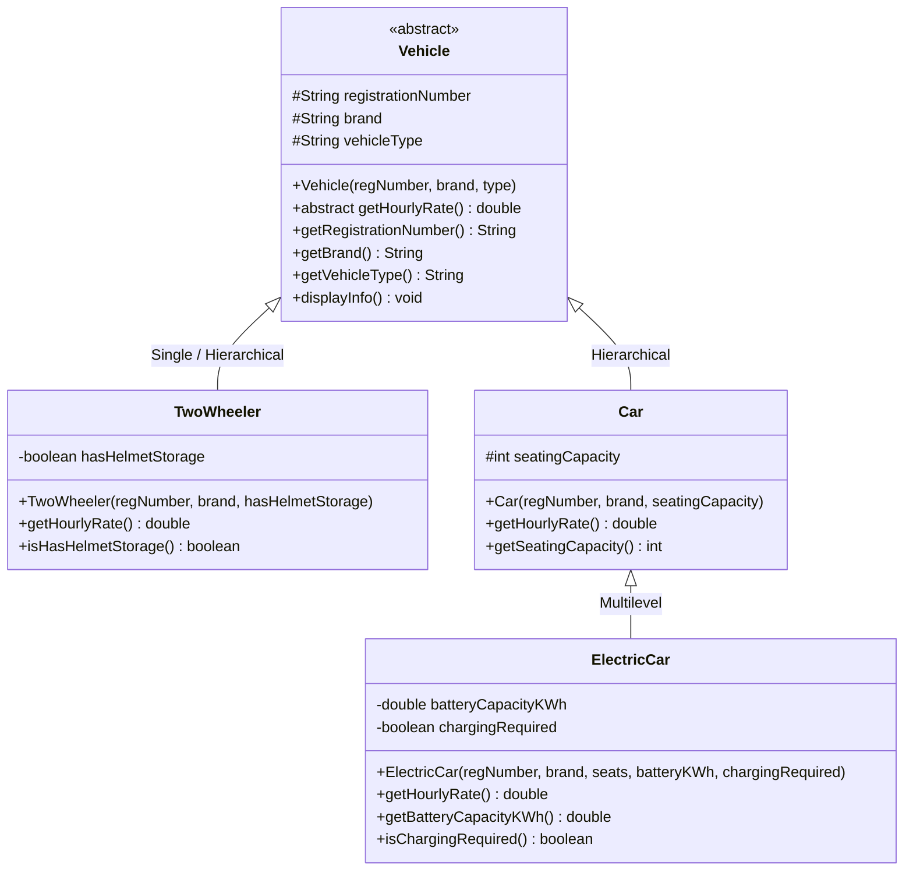

# Task 06: Inheritance

## 1. Overview
Inheritance is a foundational pillar of Object-Oriented Programming that establishes an **"is-a"** relationship between a generalized superclass and specialized subclasses. This promotes code reuse, establishes polymorphic taxonomies, and enforces interface contracts.

---

## 2. Vehicle Inheritance Hierarchy



---

## 3. Forms of Inheritance Implemented

### 3.1 Single Inheritance
A child class inherits from a single direct parent.
- Example: `TwoWheeler extends Vehicle`.

### 3.2 Hierarchical Inheritance
Multiple distinct child classes extend a single common parent class.
- Example: Both `TwoWheeler` and `Car` extend the base abstract `Vehicle` class.

### 3.3 Multilevel Inheritance
A class extends a child class, forming an ancestor-descendant chain.
- Example: `ElectricCar extends Car` which in turn `extends Vehicle` (`Vehicle -> Car -> ElectricCar`).
- `ElectricCar` inherits attributes and behavior from both `Car` and `Vehicle`.

---

## 4. Constructor Execution Order and the `super` Keyword

When a derived class object is created, constructors execute in strict **top-down** hierarchical order from the root ancestor to the leaf subclass.
```java
// Instantiating ElectricCar:
new ElectricCar("DL05EV9999", "Tata Nexon EV", 5, 40.5, true);
```

### Execution Sequence:
1. `Vehicle` constructor runs first: Allocates memory and sets root fields (`registrationNumber`, `brand`).
2. `Car` constructor runs second: Chains up using `super(...)` and initializes `seatingCapacity`.
3. `ElectricCar` constructor runs third: Chains up via `super(...)` and sets `batteryCapacityKWh` and `chargingRequired`.

The `super` keyword is used for:
- Explicitly delegating construction parameters to the immediate parent constructor (`super(...)`).
- Invoking overridden parent methods (`super.getHourlyRate()`).

---

## 5. Inheritance ("IS-A") vs. Composition ("HAS-A")

| Dimension | Inheritance (IS-A) | Composition (HAS-A) |
| :--- | :--- | :--- |
| **Relationship** | Class specialization (`Car IS-A Vehicle`) | Component aggregation (`ParkingBay HAS-A Vehicle`) |
| **Coupling** | **Tight coupling**: Subclass is dependent on parent implementation details. | **Loose coupling**: Components interact through well-defined public interfaces. |
| **Flexibility** | Static (fixed compile-time binding). Cannot change parent at runtime. | Dynamic (runtime reassignment). A parking bay can host any vehicle at any time. |
| **Design Principle** | Use when true behavioral subtyping exists (Liskov Substitution Principle). | **"Favor Composition over Inheritance"** for code assembly and state containment. |

---

## 6. Execution Instructions and Verification
Compile and run the demonstration:
```bash
javac Vehicle.java TwoWheeler.java Car.java ElectricCar.java InheritanceDemo.java
java InheritanceDemo
```
All hierarchical levels and constructor logging will display the top-down initialization order cleanly.
