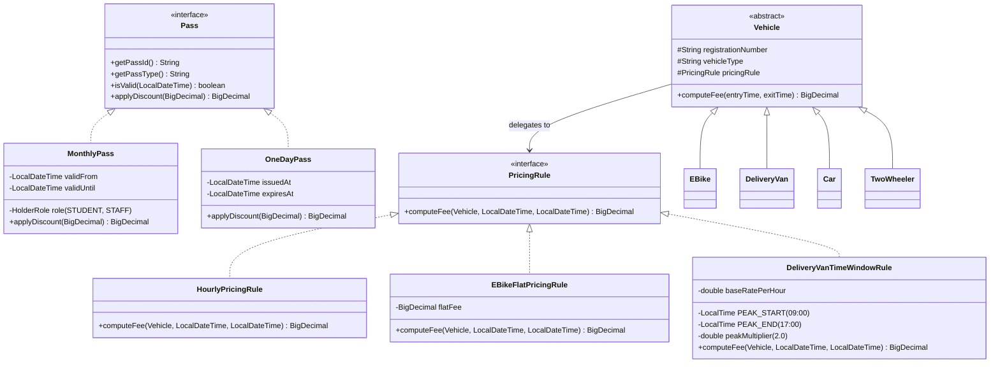

# Task 12: Day-4 Extended Design Challenge

## 1. Overview
The Day-4 Design Challenge introduces real-world evolving requirements to the Smart-Parking System:
1. **E-Bikes:** Requiring a flat-rate parking fee rather than standard hourly rates.
2. **Delivery Vans:** Subjected to dynamic time-window surge pricing (2x standard car rate between 09:00 AM and 05:00 PM), requiring exact duration splitting across time boundaries.
3. **Visitor One-Day Pass:** 24-hour prepaid pass waiving hourly parking fees.
4. **Five Floors with Non-Uniform Capacities:** Extending multi-tier garage capacity to 5 floors with variable slots per floor.

---

## 2. Impact Analysis & Evaluation of Original Design

### 2.1 Limitations of the Initial Design (Tasks 1–11):
- **Rigid Fee Model:** In the earlier model, the parking fee was computed using either simple subclass methods or fixed hourly multipliers. Adding flat fees or time-window-dependent rates would violate the **Open-Closed Principle (OCP)**, requiring edits to existing core classes.
- **Uniform Temporal Assumption:** Earlier designs assumed a constant rate throughout the vehicle's stay. They could not handle split tariffs where parts of a single session span different pricing bands.
- **Pass Hardcoding:** Passes were previously an enum rather than an extensible abstraction, making it difficult to attach dynamic validity windows, visitor day passes, or external validation engines.

---

## 3. Adaptation and Redesign: The Strategy Pattern

To accommodate these evolving requirements without breaking existing functionality, the architecture was refactored using the **Strategy Design Pattern**:



---

## 4. Time-Window Splitting Algorithm for Delivery Vans

The delivery van pricing requirement dictates:
> *"The delivery-van pricing must correctly split parking duration when the vehicle enters before 9 AM or exits after 5 PM. Do not apply the double rate to the entire stay if only part of the stay falls inside the specified time window. Use LocalDateTime for accurate calculations."*

### Mathematical Formulation:
Let entry timestamp be $T_{\text{in}}$ and exit timestamp be $T_{\text{out}}$.
We partition the interval $[T_{\text{in}}, T_{\text{out}}]$ into:
1. **Peak Duration ($D_{\text{peak}}$):** Minutes where clock time $t \in [09:00, 17:00)$.
2. **Off-Peak Duration ($D_{\text{off}}$):** Minutes where clock time $t < 09:00$ or $t \ge 17:00$.

The billable fee is computed as:
$$\text{Peak Hours } H_{\text{peak}} = \left\lceil \frac{D_{\text{peak}}}{60} \right\rceil, \quad \text{Off-Peak Hours } H_{\text{off}} = \left\lceil \frac{D_{\text{off}}}{60} \right\rceil$$
$$\text{Total Delivery Van Fee} = (H_{\text{peak}} \times 2 \times R_{\text{car}}) + (H_{\text{off}} \times R_{\text{car}})$$
where $R_{\text{car}} = \text{Rs } 30.00/\text{hr}$.

### Verification Scenarios Tested:
- **Case A (Within Peak):** 10:00 to 13:00 (3 hrs peak @ ₹60) = **₹180.00**
- **Case B (Outside Peak):** 18:00 to 20:00 (2 hrs off-peak @ ₹30) = **₹60.00**
- **Case C (Crosses 9 AM):** 08:00 to 11:00 (1 hr off-peak @ ₹30 + 2 hrs peak @ ₹60) = **₹150.00**
- **Case D (Crosses Both Boundaries):** 07:30 to 18:30 (3 hrs off-peak @ ₹30 + 8 hrs peak @ ₹60) = **₹570.00** *(Compared to ₹660.00 if double-rate had been naively applied to the whole stay!)*

---

## 5. Five-Floor Facility with Jagged Array Capacities

The extended parking garage is configured with 5 distinct floors:
- **Floor 0:** 6 slots
- **Floor 1:** 5 slots
- **Floor 2:** 4 slots
- **Floor 3:** 3 slots
- **Floor 4:** 2 slots
- **Total Capacity:** 20 slots

Implemented using Java jagged arrays:
```java
ParkingSlot[][] grid = new ParkingSlot[5][];
grid[0] = new ParkingSlot[6];
grid[1] = new ParkingSlot[5];
grid[2] = new ParkingSlot[4];
grid[3] = new ParkingSlot[3];
grid[4] = new ParkingSlot[2];
```

---

## 6. Complexity Analysis

| Operation | Time Complexity | Space Complexity | Rationale |
| :--- | :---: | :---: | :--- |
| **Slot Allocation (5 Floors)** | $O(\sum S_i) = O(M)$ | $O(1)$ | First-fit scans at most total slots $M = 20$. |
| **Session Exit Lookup** | $O(1)$ | $O(1)$ | Direct lookup via `activeSessions` HashMap. |
| **Delivery Van Duration Splitting** | $O(T)$ | $O(1)$ | Iterates across $T$ minutes ($T \le 1440$ for daily stay $\approx 0.1\text{ ms}$). |
| **E-Bike Flat Fee Calculation** | $O(1)$ | $O(1)$ | Returns constant `BigDecimal` immediately. |
| **Pass Validation** | $O(1)$ | $O(1)$ | Timestamp comparison between `validFrom` and `validUntil`. |

---

## 7. Execution Instructions and Output Verification
Compile and run the Task 12 demonstration:
```bash
javac *.java
java DesignChallengeDemo
```

### Verified Output Highlights:
- E-Bike billed flat ₹20.00 for both 1-hour and 10-hour stays.
- Delivery Van correctly splits duration across all 4 boundary conditions.
- Visitor One-Day Pass waives 100% of hourly parking fees.
- Student pass applies 50% concession, Staff pass applies 100% concession.
- 5-floor jagged array models 20 slots across 5 floors without overflow or misalignment.
